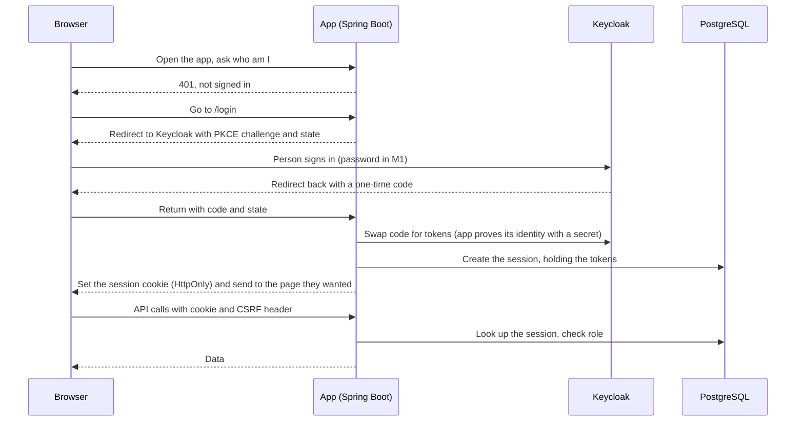

<!-- Read-only copy of Browser Sign-In: Decision, Pros and Cons, and Security Threats: https://app.notion.com/p/40d771bd4d438124b4fecedf6b8ebbfd
     Notion is the master; comment and edit there, then run docs-sync.
     Notion last edited: 2026-11-04T04:23:50.926Z · Synced: 04/11/2026 -->
<content>
<callout icon="🔐" color="gray_bg">
<b>Status:</b> Decided by the owner on 03/11/2026 and reflected in the other design docs on 04/11/2026 (see section 8) · <b>Last updated:</b> <date start="2026-11-04" /> · <b>Type:</b> Decision record for AD-15 (browser sign-in approach), with the threats we face and how we reduce them. Companion to the <mention url="https://app.notion.com/p/3f5771bd4d43819981e0f96e66fae263" /> (section 3 compares the options), the <mention url="https://app.notion.com/p/3f4771bd4d4380e28d76d2038edbfac4" /> and the <mention url="https://app.notion.com/p/3f6771bd4d4381fbadd6f819e59e08fd" />.
</callout>

<table-of-contents />

---

## 1. Decision

The Spring Boot app is the sign-in client of Keycloak (OpenID Connect, authorization code flow with PKCE). After the person signs in, the app keeps the tokens on the server and gives the browser only a session cookie that JavaScript cannot read. Sessions are stored in PostgreSQL. This is the pattern the IETF calls a Backend-for-Frontend (BFF), in its simplest form: the web app, the API and Keycloak share one hostname (AD-12, SD-02), so the app can authorise each request from its own session and does not need to relay access tokens at all. The IETF's current guidance for browser-based apps (RFC 10017) ranks this pattern as the most secure of the three it describes and strongly recommends it for business applications and apps that hold personal data. Two things are deliberately separate from this decision: how Keycloak checks who a person is (password policy, brute-force protection, two-factor sign-in, see section 7), and the session lifetimes (section 6, decided 03/11/2026).

---

## 2. How it works

- The browser never sees an access token or a refresh token. It holds one cookie.
- The app swaps the one-time code for tokens at Keycloak's internal address, the same way System Design section 2.5 already describes for a BFF.
- The API authorises from the session. Bearer tokens remain possible later for non-browser clients (the M4 public API).

---

## 3. Options considered

The IETF presents the three patterns "in decreasing order of security".

| Option | What it is | Verdict |
| --- | --- | --- |
| A. Tokens in the single-page app | The Vue app signs in with PKCE, holds the tokens and sends a bearer token with each call | Rejected. Any script that runs on the page can read or mint tokens |
| <b>B. Cookie session in the app (chosen)</b> | The server is the sign-in client and keeps the tokens; the browser holds only an HttpOnly cookie | Chosen. Strongest pattern, and cheap here because everything shares one hostname |
| B2. Separate gateway container | A proxy such as Spring Cloud Gateway swaps the cookie for a bearer token so the API stays bearer-only | Not now. One more container to run and patch, and AD-01 says one deployable. Revisit if the API is ever exposed beyond the web app |
| C. Token-mediating backend | A backend holds the refresh token but hands the access token to the browser | Rejected. The access token is still exposed, so the cost is close to A's risk with B's complexity |
| Popular sites split both ways: many (GitHub, Facebook, Instagram and banks) use cookie sessions; Microsoft's web apps use tokens in the browser. The big companies that do the latter have security teams, monitoring and very short token lifetimes that we do not. Copying their architecture would not copy their protection. |  |  |

---

## 4. Pros and cons of the chosen approach

| Pros | Cons |
| --- | --- |
| Tokens never reach the browser, so a stolen page script cannot walk away with a credential that works from another machine | Sessions are stateful: a session table in PostgreSQL (no new infrastructure, but the service is no longer purely stateless, AD-07) |
| One cookie to protect, with standard attributes the browser enforces | Cookies are sent automatically, so CSRF protection is required |
| Logout and revocation happen on the server, in one step | A deactivated person keeps working until their session ends unless we delete it (section 5, threat 8) |
| Simpler front-end code: no token storage, refresh timers or silent renewal | The web app and any future API client use different login paths |
| Keycloak still does all the hard work: passwords, reset emails, brute-force protection, later passkeys and two-factor | SameSite=Strict means the first request from a link in an email or chat arrives without the cookie, so there is one extra bounce through sign-in (to be tested) |
| Matches the recommended current practice, so it is defensible in a review (HLD sets an OWASP ASVS Level 2 baseline) | We write and maintain the session and revocation code ourselves |

---

## 5. Threats and what we do about them

No approach makes an app invulnerable. This table lists what could go wrong, what we do, and what is left over.

| # | Threat | How it could happen | What we do | What is left |
| --- | --- | --- | --- | --- |
| 1 | Stolen login token (XSS) | A script injected into the page, or a compromised npm package, reads the token | Tokens never in the browser. Content Security Policy from the web image (SD-10). Vue escapes output; no raw HTML rendering. Dependency scanning and a lockfile in CI | Low: nothing to steal |
| 2 | Script acts as the user while the page is open | The same injected script sends requests from the person's own browser, so it is "client hijacking" | Content Security Policy limits where scripts load from and where data can be sent; short idle timeout; sensitive actions (submit, approve) are signed and logged (FR-26) | <b>Accepted.</b> No cookie design stops this; the fix is preventing XSS |
| 3 | Cross-site request forgery (CSRF) | A malicious site makes the browser send a request with the cookie | SameSite=Strict cookie; Spring Security CSRF token plus a required custom header on API calls; no state changes on GET; Origin and Fetch Metadata checks | Low |
| 4 | Session fixation | An attacker plants a known session ID before login | New session ID on login and after a password change (Spring does this by default; we test it) | Low |
| 5 | Session ID sniffed on the network | Traffic read on a shared Wi-Fi | HTTPS everywhere outside the host (SD-05), HSTS, Secure cookie. Plain HTTP only between containers on the one host | Low |
| 6 | Session ID guessed | Brute-force guessing of IDs | Random, at least 128-bit session IDs from a secure generator | Negligible |
| 7 | Cookie injected from a sibling subdomain | A hostile or taken-over subdomain sets a cookie | <code>__Host-</code> cookie prefix (Secure, Path=/, no Domain); HSTS without includeSubDomains is already set so other services are unaffected | Low |
| 8 | Deactivated person keeps access (FR-25) | Their session outlives the account change | Admin deactivate and password reset delete that person's sessions in the store; Keycloak back-channel logout as a backstop (to be verified, see section 8); idle and absolute timeouts bound the worst case | Low once built; <b>this is a required ticket</b> |
| 9 | Session table read by an attacker | Database access exposes live session IDs | Encrypted disk and encrypted backups (SD-04, SD-07); database not reachable from outside; short lifetimes; sessions deleted on logout and expiry | Medium-low. Hashing session IDs in the store is a possible hardening |
| 10 | Password guessing or stuffing | Automated attempts at the Keycloak sign-in page | Keycloak brute-force protection (off by default, so the realm config must turn it on); password policy; Account Console off | Password rule and breached-password check as decided in section 7; two-factor sign-in and passkeys follow in M2 |
| 11 | Login redirect abuse | Tricking the app into sending a person to a hostile site after login | Exact redirect URI matching in Keycloak; PKCE with S256 and a state value; the return-to address must be a relative path on our own site | Low |
| 12 | Authorization code stolen or replayed | Code intercepted in the redirect | PKCE, one-time codes, exchange done server-side over the internal address | Low |
| 13 | Clickjacking | The app loaded inside a hostile page's frame | Frame-blocking policy in the Content Security Policy and headers at the entry point | Low |
| 14 | Tokens leaked through logs or URLs | Tokens written to logs or sent in query strings | Tokens never in URLs; logs scrubbed; correlation IDs instead | Low |
| 15 | Lost or shared phone | Someone else uses an open session | Idle timeout; Sign out button; Keycloak session ends with it | <b>Accepted</b> for M1 |
| 16 | Keycloak admin console attacked | Exposed admin interface | Admin paths never public, reachable only over WireGuard (SD-03); named admin with two-factor sign-in | Low |
| <b>Accepted residual risks in M1:</b> a script already running on the page can act as the user (threat 2); a stolen unlocked phone can be used until the idle timeout; sign-in is password-only until M2 adds two-factor sign-in and passkeys. |  |  |  |  |

---

## 6. Configuration summary

| Setting | Value | Why |
| --- | --- | --- |
| Cookie name and attributes | <code>__Host-</code> prefix, Secure, HttpOnly, SameSite=Strict, Path=/, no Domain | RFC 10017 and OWASP |
| Session store | PostgreSQL (Spring Session, JDBC) | No new infrastructure (AD-07 consequence) |
| Session ID | At least 128 bits, secure random | OWASP |
| Idle timeout | 30 minutes (decided 03/11/2026) | OWASP gives 15 to 30 minutes for low-risk apps; autosave is server-side, so nothing is lost |
| Absolute timeout | 8 hours (decided 03/11/2026) | OWASP's example for a working day is 4 to 8 hours; matched to Keycloak's SSO Session Max |
| Keycloak client | Confidential client with a secret from the environment (AD-09); PKCE S256; exact redirect URI | RFC 9700 |
| CSRF | Spring Security token plus required custom header; no state change on GET | OWASP |
| New session | On login and after a password change | OWASP |
| On deactivate or password reset | Delete that person's sessions | Threat 8 |
| Decided by the owner on 03/11/2026: 30 minutes idle and 8 hours absolute. Autosaves count as activity. Keycloak's own session idle and maximum are set to the same values, so a signed-out person must retype their password and an unlocked phone can't sign straight back in. |  |  |

---

## 7. Related: how Keycloak checks the person (not part of this decision)

- <b>Brute-force protection</b> is off by default in Keycloak. The System Design lists it as on, so the realm configuration in the repo must set it.
- <b>Password policy.</b> The M1 rule is at least 8 characters with letters and numbers, and no two-factor sign-in. NIST SP 800-63B-4 says a password used alone should be at least 15 characters, with no composition rules, a check against breached and common passwords, and no forced periodic changes. 8 characters is allowed only when a second factor is also used. <b>Decided by the owner on 03/11/2026:</b> keep 8 characters with letters and numbers for M1 (PRD FR-01 and the sign-in screens stay as they are) and add a check against known breached passwords, using the Have I Been Pwned Pwned Passwords range API (ticket BE-10). Only the first 5 characters of the password's SHA-1 hash leave the server. If the service can't be reached, the password is accepted and a warning is logged. Brute-force protection stays on. <b>Accepted gap:</b> 8 characters is below NIST's 15 for a password used alone. The breached-password check covers the most important NIST point, and the gap closes in M2 when a second factor or passkeys arrive.
- <b>Passkeys</b> are officially supported in Keycloak 26.4 and later. Decided 03/11/2026: passkeys come in M2 with the two-factor work, after the final domain is settled (passkeys are tied to the domain). They sit beside the password without changing this design. Not checked: which Keycloak version we will run (BE-10 pins it).

---

## 8. What changes elsewhere

<b>Plan:</b> the contract gains login, logout and "who am I" endpoints and the CSRF header rule; a 401 shows the "You've been signed out" dialog (AC-22). The mock API must behave the same way (a signed-in flag and the same 401). Back end gains one ticket for cookie sign-in and session revocation (BE-09, roughly 5 points) and one for the breached-password check (BE-10, roughly 3 points). The front end has no token code. <b>Changes made to the other design docs on 04/11/2026:</b>

- HL Design Doc: AD-15 status becomes decided; AD-07 "JWT bearer tokens" wording changes to "server-side sessions for the browser"; the sign-in diagram note.
- System Design: the AD-15 decision record; the session cookie and its attributes; session store in PostgreSQL.
- FE Detailed Design: section 3 recommendation becomes the decision; open question closed.
- BE Detailed Design: session and revocation module, Keycloak client settings. <b>To check before relying on them:</b>

- [ ] Keycloak back-channel logout together with Spring's cookie CSRF protection (a Spring Security issue reports it failing).
- [ ] SameSite=Strict: first request from an emailed link.
- [x] Final session timeouts: decided 03/11/2026 (section 6).
- [x] Password policy: decided 03/11/2026 (section 7).

---

## 9. Sources

- [RFC 10017, OAuth 2.0 for Browser-Based Applications](https://datatracker.ietf.org/doc/rfc10017/)
- [RFC 9700, OAuth 2.0 Security Best Current Practice](https://datatracker.ietf.org/doc/rfc9700/)
- [OWASP Session Management Cheat Sheet](https://cheatsheetseries.owasp.org/cheatsheets/Session_Management_Cheat_Sheet.html)
- [OWASP CSRF Prevention Cheat Sheet](https://cheatsheetseries.owasp.org/cheatsheets/Cross-Site_Request_Forgery_Prevention_Cheat_Sheet.html)
- [NIST SP 800-63B-4, Authenticators](https://pages.nist.gov/800-63-4/sp800-63b/authenticators/)
- [Keycloak passkeys support](https://www.keycloak.org/2025/09/passkeys-support-26-4)
- [Keycloak Server Administration Guide](https://www.keycloak.org/docs/latest/server_admin/index.html)

---

## 10. Revision history

| Date | Change |
| --- | --- |
| <date start="2026-11-04" /> | The other design docs now reflect this decision (sections 8 and the status line). Two-factor sign-in and passkeys both come in M2, matching the PRD roadmap. |
</content>
