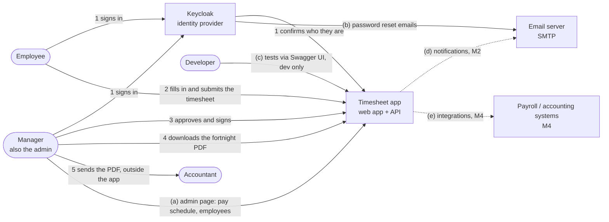
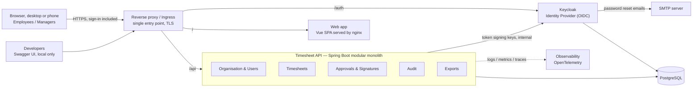
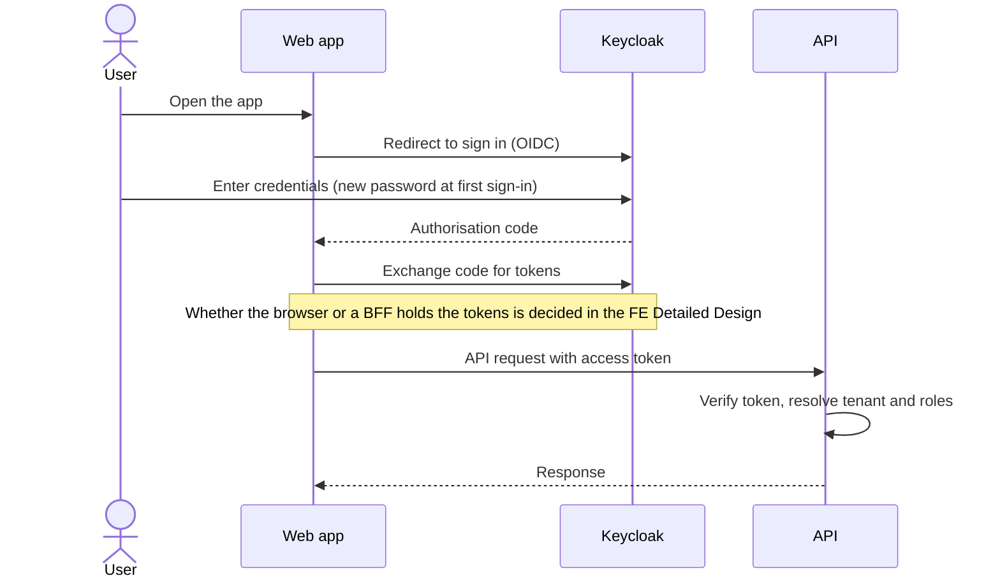
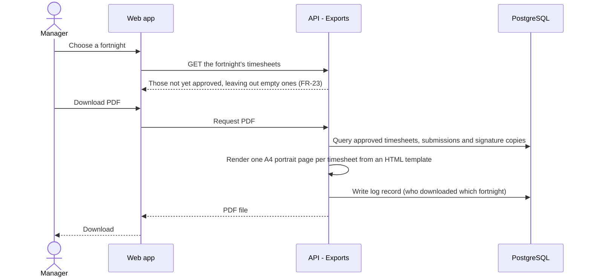

<!-- Read-only copy of HL Design Doc: https://app.notion.com/p/3f4771bd4d4380e28d76d2038edbfac4
     Notion is the master; comment and edit there, then run docs-sync.
     Notion last edited: 2026-10-17T14:50:54.676Z · Synced: 18/10/2026 -->
<content>
<callout icon="📄" color="gray_bg">
	**Status:** Draft · **Last updated:** <mention-date start="2026-10-18"/> · **Type:** High-level solution design — *what* the system is, covering both the web front end and the backend. Why each decision was made, and how the system runs, are in the <mention-page url="https://app.notion.com/p/3f6771bd4d4381fbadd6f819e59e08fd"/>. Requirements live in the <mention-page url="https://app.notion.com/p/3f5771bd4d438156a93ec42b3548821d"/>; implementation detail lives in the <mention-page url="https://app.notion.com/p/3f5771bd4d43813e90c8e11492d92e2b"/> and the <mention-page url="https://app.notion.com/p/3f5771bd4d43819981e0f96e66fae263"/>.
</callout>
<table_of_contents/>
---
## 1. Context
The MVP for this timesheet app lets 
1. Employees fill in their fortnightly hours
2. The manager approve and sign timesheets
3. The manager to download the timesheets (grouped by pay cycle) in one PDF for the business's accountant with a log of workflow and admin actions (see the <mention-page url="https://app.notion.com/p/3f5771bd4d438156a93ec42b3548821d"/>). 
It is delivered as a Vue web app and a Spring Boot API.
M1 (MVP) is self-hosted for one small business on a single home machine, reached through a rented relay server. M3 moves it to Kubernetes as a multi-tenant SaaS without re-architecture.
This document describes the solution at a high level: what drives the architecture, the main building blocks and how they interact, how it's deployed, and the key decisions. The reasoning behind each decision, and the detail of how the system runs, are in the <span discussion-urls="discussion://3f4771bd-4d43-80e2-8d76-d2038edbfac4/e8840be0-1538-4cbc-b460-b7768791db6b/3f6771bd-4d43-80b1-afa4-001c3478e02a"><mention-page url="https://app.notion.com/p/3f6771bd4d4381fbadd6f819e59e08fd"/></span>.
---
## 2. Architecture drivers
### 2.1 Quality attributes
Each row is a quality the system must have: the target it must hit, and what the design does to meet it. Why each choice was made is in the System Design.
<table header-row="true">
<colgroup>
<col width="126.328125">
<col width="234.33333333333334">
<col width="297.328125">
</colgroup>
<tr>
<td>Driver</td>
<td>Target</td>
<td><span discussion-urls="discussion://3f4771bd-4d43-80e2-8d76-d2038edbfac4/d5e9dc2f-51d5-42cc-953a-881a7b1c7947/3f6771bd-4d43-80c1-aa8f-001c638b6562">How the design meets it</span></td>
</tr>
<tr>
<td>**Auditability**</td>
<td>  • Every workflow and admin action listed (in <span discussion-urls="discussion://3f4771bd-4d43-80e2-8d76-d2038edbfac4/6a846035-43f8-47de-8353-70e2452d12fe/3f6771bd-4d43-8022-8b10-001c90b5e1e6">FR-26</span> of the <mention-page url="https://app.notion.com/p/3f5771bd4d438156a93ec42b3548821d"/>) are logged with who, when and what.<br>  • Log records are append-only. <br>  • Draft autosaves and the Clear action aren't logged; the later deletion of a cleared rejected timesheet is (FR-13). <br>  • Account changes made directly in Keycloak are recorded by Keycloak's admin events, kept indefinitely (FR-26).</td>
<td>  • Log record written in the same transaction as the action (AD-06), dedicated Audit module.<br>  • Keycloak admin events turned on with no expiry, covered by the Keycloak database backup.</td>
</tr>
<tr>
<td>**Security**</td>
<td>  • OIDC / OAuth2 authentication with server-side role-based authorisation<br>  • <span discussion-urls="discussion://3f4771bd-4d43-80e2-8d76-d2038edbfac4/e2fdd4e0-e484-4931-adc7-b912b7b2f8c4/3f6771bd-4d43-8096-873b-001c7bf7e3e6">Least privilege</span>: every person, service and account gets only the access it needs<br>  • <span discussion-urls="discussion://3f4771bd-4d43-80e2-8d76-d2038edbfac4/e2fdd4e0-e484-4931-adc7-b912b7b2f8c4/3f6771bd-4d43-802a-9594-001c9e5421d0">OWASP Top 10 / ASVS Level 2 baseline</span>: built and tested against OWASP's list of the ten most common web-app security risks, and level 2 of its Application Security Verification Standard, the level meant for apps that hold personal data<br>  • TLS outside local dev<br>  • <span discussion-urls="discussion://3f4771bd-4d43-80e2-8d76-d2038edbfac4/e2fdd4e0-e484-4931-adc7-b912b7b2f8c4/3f6771bd-4d43-8011-bbf4-001c1e2d048d">No secrets in code or images.</span> Checked automatically: a secret scan runs before every commit, so a secret never enters the history, and again in CI on the code and the container images.</td>
<td>  • External identity provider (AD-04)<br>  • Authorisation in the API (AD-05)<br>  • Browser sign-in approach chosen deliberately (AD-15)<br>  • One public entry point for all traffic, sign-in included (AD-20)<br>  • Nothing open to the internet at home (AD-21)<br>  • Content Security Policy on the web app<br>  • Secret scanning before every commit and in CI.</td>
</tr>
<tr>
<td>**Multi-tenancy**</td>
<td>  • M1: one business per install<br>  • From M3: strict isolation, no request can read or write another tenant's data.</td>
<td>  • Tenant identifier on every tenant-owned record from M1, so M3 adds businesses without changing M1 data<br>  • Database-level enforcement by M3 (AD-03).</td>
</tr>
<tr>
<td>**Availability**</td>
<td>  • M1: one self-hosted instance, recovered from a tested backup<br>  • M3: cloud target 99.9%.</td>
<td>  • M1: automatic restarts, monitoring from the relay and a tested restore (AD-19, AD-21).<br>  • M3: stateless services, horizontal scaling, health / readiness probes, graceful shutdown (AD-07).</td>
</tr>
<tr>
<td>**Recoverability**</td>
<td>  • A documented backup and restore procedure, with a restore tested before go-live (PRD section 7). The install holds the record of what people are owed.</td>
<td>  • All state in PostgreSQL (app and Keycloak databases, signature images included) plus the install's configuration, so one backup covers everything (AD-19, section 6).</td>
</tr>
<tr>
<td>**Performance**</td>
<td>  • API p95 under 300 ms for standard operations at M1 load.<br>  • Web app core screens meet Core Web Vitals "good" (LCP ≤ 2.5 s, INP ≤ 200 ms).</td>
<td>  • Static web app served by nginx, efficient queries<br>  • Heavy work (exports) can move to background jobs.</td>
</tr>
<tr>
<td>**Portability**</td>
<td>  • Runs identically on Docker Compose and Kubernetes<br>      ◦ No cloud-vendor lock-in.</td>
<td>  • Containers (AD-08); 12-factor configuration (AD-09); vendor-neutral building blocks only.</td>
</tr>
<tr>
<td>**Observability**</td>
<td>Structured logs, metrics, traces and correlation IDs from browser request to database.</td>
<td>OpenTelemetry instrumentation; health endpoints on every service.</td>
</tr>
<tr>
<td>**Data integrity**</td>
<td>No hard deletes of submitted or approved timesheets, people or the log (never-submitted drafts are deleted on submit, on clear or 15 days after their last change; a cleared rejected timesheet 3 months after clearing, logged; FR-12, FR-13); no lost updates; hours correct on DST change days.</td>
<td>Deactivate rather than delete (FR-25); optimistic concurrency (autosave from two devices); work times stored as a local date and times in the business's time zone, hours calculated on the server and stored exactly, as whole minutes, and rounded only for display (FR-10, FR-11); system timestamps as UTC instants.</td>
</tr>
<tr>
<td>**Privacy (GDPR)**</td>
<td>M1 keeps data indefinitely (PRD section 7). From M3: self-service personal data access and erasure without breaking the log.</td>
<td>Erasure by pseudonymising personal data in log records rather than deleting them (M3); retention revisited before M3.</td>
</tr>
<tr>
<td>**Maintainability**</td>
<td>Clear boundaries, automated quality gates, recorded decisions.</td>
<td>Modular monolith with enforced module boundaries (AD-01); OpenAPI contract (AD-13); ADRs.</td>
</tr>
</table>
### 2.2 Constraints
- **Open source only** — every dependency must meet the licence policy (section 11).
- **Self-hosted first, cloud-ready** — M1 runs on a single home machine behind a rented relay (AD-21); M3 moves to Kubernetes with the same images.
- **One time zone** — all times are in the business's time zone (PRD section 2).
- **Tenant-ready data model** — M3 must add businesses, and M4 dimensions (projects, clients, sites), without changing M1 data (PRD section 2).
- **Vendor-neutral** — nothing that only works on one cloud provider.
### 2.3 Out of scope for this design
- Server-side rendering of the web app (see AD-11)
- Microservices, message brokers, caches — until there's a measured need
- Production cloud deployment (designed for, delivered in M3)
- Features the PRD places after M1 (PRD sections 4 and 9) — the design leaves room for them but doesn't build them
---
## 3. System context
Who and what the app interacts with. Numbers follow a fortnight, 1 to 5; letters mark supporting and later interactions; dashed lines are later milestones.

---
## 4. Containers & modules
### 4.1 Containers

<table header-row="true">
<tr>
<td>Container</td>
<td>Responsibility</td>
</tr>
<tr>
<td>**<span discussion-urls="discussion://3f4771bd-4d43-80e2-8d76-d2038edbfac4/97c75f4b-c9f0-4ea4-9bda-c031aaf643e6/3f6771bd-4d43-80fd-a374-001cc73aab6d">Reverse proxy / Ingress</span>**</td>
<td>Single entry point for all traffic, sign-in included; TLS; routes `/` to the web app, `/api` to the API and `/auth` to Keycloak; Keycloak's admin console is never routed. Caddy in M1, an Ingress in M3 (AD-20).</td>
</tr>
<tr>
<td>**Web app**</td>
<td>Vue single-page app, served as static files. Presentation only — no business rules it alone enforces.</td>
</tr>
<tr>
<td>**Timesheet API**</td>
<td>All business logic, hours calculation, authorisation, the action log and the PDF. Exposes the versioned REST API, plus Swagger UI as a developer tool, switched off in the production install.</td>
</tr>
<tr>
<td>**Keycloak**</td>
<td>User accounts, sign-in, temporary passwords changed at first sign-in, password change from the Profile page, password reset emails (FR-01); admin events record account changes made directly in Keycloak (FR-26); issues tokens. Its sign-in pages use a login theme that matches the app and shows the business's name and logo (FR-28). Two-factor sign-in for the manager in M2 (SD-03); single sign-on available when needed.</td>
</tr>
<tr>
<td>**PostgreSQL**</td>
<td>System of record for timesheets, signatures, the business logo and the log (and Keycloak's own data, in a separate database). Backed up as one unit (section 6).</td>
</tr>
<tr>
<td>**Observability**</td>
<td>Collects logs, metrics and traces. Backend tools chosen in the Detailed Design.</td>
</tr>
</table>
How the browser signs in (tokens held in the browser vs a Backend-for-Frontend) is decided in the FE Detailed Design; the containers above hold either way.
### 4.2 API modules
<table header-row="true">
<tr>
<td>Module</td>
<td>Responsibility</td>
<td>Owns</td>
</tr>
<tr>
<td>**Organisation & Users**</td>
<td>Business settings (name and optional logo, shown on the sign-in pages, FR-28; time zone; pay schedule start date, which must be a Monday, and its lock, FR-04–FR-06), employee accounts (FR-24, FR-25), through Keycloak's admin API. The one manager's role is set in Keycloak. More managers, reporting lines and approver overrides arrive in M2.</td>
<td>Business (the tenant), people, pay schedule</td>
</tr>
<tr>
<td>**Timesheets**</td>
<td>Fortnights, one row per weekday (start time, rest break, finish time), autosaved drafts, the 15-day expiry of never-submitted ones and the 3-month deletion of cleared rejected ones, validation, soft warnings and hours calculation in whole minutes (FR-07–FR-13, FR-27)</td>
<td>Timesheets, timesheet days</td>
</tr>
<tr>
<td>**Approvals & Signatures**</td>
<td>Submit (with the employee's declaration, warning-day ticks and signature) / approve / reject transitions, everyone's stored signature (Profile page), signature copies on each submission and approval, self-approval marking (FR-14–FR-21). M1 has one manager, but checks are on the Manager role, not a count, so M2 can add more managers, routing, recall and reopen without rework.</td>
<td>Workflow state and decisions, signatures, per-submission and per-approval signature copies</td>
</tr>
<tr>
<td>**Audit**</td>
<td>Append-only log of the workflow and admin actions in FR-26 (not autosaves). No log screen in M1; the audit history screen arrives in M2.</td>
<td>Log records</td>
</tr>
<tr>
<td>**Exports**</td>
<td>The fortnight PDF of approved timesheets (FR-22, FR-23). Excel export and reports arrive in M2.</td>
<td>Nothing — reads from other modules</td>
</tr>
</table>
**Module rules:** modules talk only through each other's public interfaces, never each other's tables; every module is tenant-aware; boundaries are checked by automated architecture tests.
Projects, clients and other dimensions arrive in M4 as a new module that adds to timesheet days without changing M1 data.
---
## 5. Key flows
### 5.1 Sign in and call the API

### 5.2 Fill in, submit and approve a timesheet
```mermaid
sequenceDiagram
    actor E as Employee
    actor M as Manager
    participant W as Web app
    participant A as API
    participant D as PostgreSQL
    E->>W: Enter a day's start time, rest break and finish time
    W->>A: PUT the day (autosave, no Save button)
    A->>A: Validate, calculate minutes
    A->>D: Save to the Draft timesheet (not logged)
    A-->>W: Calculated hours, plus a warning if 1h or less or over 12h
    E->>W: Submit, then review days, warnings and totals
    E->>W: Tick the declaration and each day with a warning
    W->>A: POST submit with the ticks
    A->>A: Check ownership, Draft state, a day with hours, every filled-in day, the ticks and a signature
    A->>D: Set status Submitted + store submission with signature copy + write log record with the hours (one transaction)
    A-->>W: OK
    M->>W: Open Approvals for a fortnight
    W->>A: GET submitted timesheets
    A->>D: Query the fortnight's submitted timesheets
    A-->>W: Submitted list, with any warnings
    M->>W: Approve (or reject with a reason)
    W->>A: POST approve
    A->>A: Check Manager role and signature; mark Self-approved if it's their own
    A->>D: Set status Approved + copy signature + write log record (one transaction)
    A-->>W: OK
```
Reject follows the same path: a reason is required, the timesheet returns to Draft showing the reason, and the rejection is logged (FR-17, FR-26).
### 5.3 Download the fortnight PDF

In M1 the PDF is rendered on request: one small business, one page per approved timesheet. Each page copies the business's current paper timesheet: title, employee, pay period (Monday of week 1 to Friday of week 2), Week 1 and Week 2 tables with Monday to Friday as rows and weekly totals, and the fortnight total. A signature section follows, with the employee's name, signature and confirmation date and time and the approver's name, signature, approval date and time and any Self-approved mark (FR-16, FR-19, FR-22). It's rendered from an HTML template with OpenHTMLtoPDF (decided; details in the BE Detailed Design). Every hours figure, on screen and in the PDF, shows both forms, e.g. 8h 10m (8.17), rounded half-up to 2 places for display only, with FR-11's note that totals may differ slightly from the sum of the rounded daily figures. Background jobs can come later if exports grow.
---
## 6. Deployment view
The detail of how the system runs (request path, hosting, TLS, environments, scaling, capacity, backups and failure handling) is in the <mention-page url="https://app.notion.com/p/3f6771bd4d4381fbadd6f819e59e08fd"/>.
<table header-row="true">
<tr>
<td>Concern</td>
<td>M1 (MVP)</td>
<td>M3</td>
</tr>
<tr>
<td>Hosting</td>
<td>One home machine running Docker Compose, reached through a rented relay server; no ports open at home (AD-21)</td>
<td>Kubernetes cluster, deployed with Helm</td>
</tr>
<tr>
<td>Entry point</td>
<td>Caddy reverse proxy (AD-20)</td>
<td>Cloud load balancer and an Ingress controller</td>
</tr>
<tr>
<td>TLS</td>
<td>Required; certificates from Let's Encrypt, renewed automatically by Caddy. Caddy's local certificates in local development</td>
<td>Required; certificates from cert-manager</td>
</tr>
<tr>
<td>Packaging</td>
<td>Same container images</td>
<td>Same container images</td>
</tr>
<tr>
<td>Scaling</td>
<td>One instance of each</td>
<td>Web and API scale horizontally; the database is the scaling boundary</td>
</tr>
<tr>
<td>Database</td>
<td>PostgreSQL container with a volume</td>
<td>Managed PostgreSQL or an in-cluster operator, decided in M3</td>
</tr>
<tr>
<td>Configuration & secrets</td>
<td>`.env` and secret files</td>
<td>ConfigMaps and Secrets (or an external secret store)</td>
</tr>
<tr>
<td>Backups</td>
<td>Nightly, encrypted, off-site; restore tested before go-live (AD-19)</td>
<td>Managed backups with point-in-time recovery</td>
</tr>
<tr>
<td>Admin access</td>
<td>Over WireGuard only; two-factor sign-in for the manager in M2</td>
<td>Provider access controls; Keycloak's admin console never public</td>
</tr>
</table>
---
## 7. Cross-cutting concerns
- **Identity & access** — Keycloak handles who you are; the API decides what you may do, per organisation and role. The web app only hides actions — the API enforces them. M1 has two roles, Employee and Manager, and exactly one manager, who is also the admin. The API checks the role, never a count of managers.
- **Entry point & TLS** — all traffic, sign-in included, enters through one HTTPS entry point (Caddy in M1, an Ingress in M3) that routes `/`, `/api` and `/auth`; Keycloak's admin console is never public, and admin access is over WireGuard only (AD-20, AD-21).
- **Multi-tenancy** — M1 runs one business, but every tenant-owned record carries the tenant identifier from the start, so M3 can add businesses without changing M1 data. From M3 the tenant is resolved from the signed-in user and isolation is enforced in the database as well as the code (strategy in the BE Detailed Design).
- **Audit** — each workflow and admin action in FR-26 writes an append-only log record in the same transaction; draft autosaves and Clear aren't logged. Personal data in log records is pseudonymised on erasure (M3).
- **Time handling** — one time zone, the business's, set in configuration. Each weekday (Monday to Friday) stores a local date and local start and finish times; weekend and overnight shifts are M2. Hours are calculated on the server and stored exactly, as whole minutes (times are entered to the minute); every total is calculated from them. Wherever a shift is shown, on screen and in the PDF, its times use a 12-hour clock with AM/PM and its hours the form `{hours}h {minutes}m` with two-digit minutes, e.g. 7:30 AM to 8:30 PM, 30 min break, 12h 30m; weekly and fortnight totals can pass 24 hours (76h 30m); every hours figure on screen and in the PDF adds decimal hours in brackets, rounded half-up to 2 places only for display (FR-11). The API carries 24-hour times and integer minutes; this display is formatting in the web app and the PDF template. Fortnights repeat every 14 days from the start date a manager sets, which must be a Monday (FR-04). System timestamps (log, submissions, approvals) are UTC instants. Rules in the BE Detailed Design.
- **API conventions** — versioned paths (`/api/v1`), a standard error format, pagination; the OpenAPI spec generates the web app's API client.
- **Drafts & autosave** — the web app saves each change to a server-side draft; there is no Save button. The draft is deleted when the timesheet is submitted or cleared. A draft that has never been submitted expires 15 days after its last change and the timesheet shows that date; a daily job deletes expired drafts. Rejected timesheets with hours never expire; a rejected timesheet that is cleared is deleted 3 months later unless hours are entered again, the timesheet shows that date too, and the deletion is logged (FR-12, FR-13, FR-17, AD-18).
- **Warnings** — a day with 1 hour or less, or more than 12 hours, of worked time (after the break) gets a non-blocking warning ("Is AM/PM correct?") on its row, in the submit review and on Approvals (FR-15, FR-27). The server returns warnings with the calculated hours, so every view agrees.
- **Submit confirmation** — Submit is available once a day has hours, even before the fortnight ends. It opens a review; the employee ticks one declaration ("I confirm these hours are correct") plus a tick for each day with a warning. Their signature, name and the date and time are then applied, stored with the submission, logged and printed on the PDF (FR-14, FR-22, FR-26).
- **Signatures** — everyone sets up a signature on the Profile page (drawn, or generated from typed text, their name by default). It's stored once as an image and copied onto each submission and approval, so replacing it never changes earlier timesheets. Anyone without one is prompted at their first submit or approval (FR-20, FR-21).
- **Observability** — OpenTelemetry across web app and API; a correlation ID follows each request end to end.
- **Configuration & secrets** — externalised per environment; nothing secret in code or images.
- **Backup & restore** — a documented, tested procedure is part of the M1 deliverable (section 6, AD-19).
---
## 8. Key architectural decisions
Why each decision was made, with the options considered, is in the System Design (section 13).
<table header-row="true">
<tr>
<td>ID</td>
<td>Decision</td>
</tr>
<tr>
<td>AD-01</td>
<td>**Modular monolith**: one deployable with enforced internal module boundaries</td>
</tr>
<tr>
<td>AD-02</td>
<td>**API-first REST + OpenAPI 3**, versioned (`/api/v1`)</td>
</tr>
<tr>
<td>AD-03</td>
<td>**Tenant-aware from day one**, single tenant deployed initially; isolation strategy decided before M3</td>
</tr>
<tr>
<td>AD-04</td>
<td>**External identity provider (Keycloak, OIDC)**</td>
</tr>
<tr>
<td>AD-05</td>
<td>**RBAC scoped per organisation**, enforced in the API; two roles in M1, Employee and Manager; checks on the role, not a count of managers</td>
</tr>
<tr>
<td>AD-06</td>
<td>**Log written in the same transaction** as the action</td>
</tr>
<tr>
<td>AD-07</td>
<td>**Stateless service**, JWT bearer tokens</td>
</tr>
<tr>
<td>AD-08</td>
<td>**Containers as the unit of deployment**: the same images on Docker Compose and on Kubernetes (Helm)</td>
</tr>
<tr>
<td>AD-09</td>
<td>**12-factor configuration**: all configuration and secrets from the environment</td>
</tr>
<tr>
<td>AD-10</td>
<td>**Single PostgreSQL database with versioned migrations** (Flyway)</td>
</tr>
<tr>
<td>AD-11</td>
<td>**Web app as a Vue 3 + TypeScript single-page app** (client-side rendering)</td>
</tr>
<tr>
<td>AD-12</td>
<td>**Web app in its own container, on the same domain as the API** (`/` → web app, `/api` → API)</td>
</tr>
<tr>
<td>AD-13</td>
<td>**OpenAPI spec is the front-end / backend contract**; the web app's client is generated from it</td>
</tr>
<tr>
<td>AD-14</td>
<td>**Monorepo** for web app, backend and deployment config</td>
</tr>
<tr>
<td>AD-15</td>
<td>**Browser sign-in approach decided in the FE Detailed Design** (tokens in the SPA vs Backend-for-Frontend)</td>
</tr>
<tr>
<td>AD-16</td>
<td>**Deliver in end-to-end slices**, each with its API and screens: (1) Profile signature, My timesheet and submit, (2) approvals, (3) admin page, (4) PDF</td>
</tr>
<tr>
<td>AD-17</td>
<td>**PDF generated on the server**, on request</td>
</tr>
<tr>
<td>AD-18</td>
<td>**Drafts are server-side, autosaved**; no timesheet data in browser storage</td>
</tr>
<tr>
<td>AD-19</td>
<td>**Backup and restore are part of the deliverable**</td>
</tr>
<tr>
<td>AD-20</td>
<td>**One public entry point for all traffic, including sign-in**: Caddy reverse proxy in M1, an Ingress in M3; Keycloak's admin console never public</td>
</tr>
<tr>
<td>AD-21</td>
<td>**M1 hosted on a home machine behind a rented relay server**: a WireGuard tunnel opened from home, TLS ending at home, no ports open on the home router</td>
</tr>
</table>
---
## 9. Technology choices
High-level choices only. Why each was chosen is in the System Design (section 13.3); versions, libraries and configuration are in the BE and FE Detailed Design docs.
<table header-row="true">
<tr>
<td>Area</td>
<td>Choice</td>
<td>Licence</td>
</tr>
<tr>
<td>Backend language / runtime</td>
<td>Java 25 (LTS), OpenJDK build (e.g. Eclipse Temurin)</td>
<td>GPLv2 + Classpath Exception</td>
</tr>
<tr>
<td>Backend framework</td>
<td>Spring Boot 4.x</td>
<td>Apache 2.0</td>
</tr>
<tr>
<td>Backend build</td>
<td>Maven (with Maven Wrapper)</td>
<td>Apache 2.0</td>
</tr>
<tr>
<td>Front-end framework</td>
<td>Vue 3 + TypeScript</td>
<td>MIT / Apache 2.0</td>
</tr>
<tr>
<td>Front-end build</td>
<td>Vite</td>
<td>MIT</td>
</tr>
<tr>
<td>UI components</td>
<td>Nuxt UI (v4), on Reka UI and Tailwind CSS v4, used in the plain Vue + Vite app through its Vite plugin (no Nuxt framework)</td>
<td>MIT</td>
</tr>
<tr>
<td>Web server (inside the web app image)</td>
<td>nginx, serving the built web app as static files</td>
<td>BSD-2-Clause</td>
</tr>
<tr>
<td>Reverse proxy *(M1)*</td>
<td>Caddy, with automatic certificates from Let's Encrypt</td>
<td>Apache 2.0</td>
</tr>
<tr>
<td>Relay server *(M1)*</td>
<td>WireGuard tunnel; nginx stream module as the TCP relay</td>
<td>GPLv2, as separate infrastructure / BSD-2-Clause</td>
</tr>
<tr>
<td>Database</td>
<td>PostgreSQL</td>
<td>PostgreSQL Licence</td>
</tr>
<tr>
<td>Schema migrations</td>
<td>Flyway (Community)</td>
<td>Apache 2.0</td>
</tr>
<tr>
<td>Identity</td>
<td>Keycloak</td>
<td>Apache 2.0</td>
</tr>
<tr>
<td>API docs / test UI</td>
<td>springdoc-openapi + Swagger UI (local development only)</td>
<td>Apache 2.0</td>
</tr>
<tr>
<td>PDF export</td>
<td>OpenHTMLtoPDF (HTML template → PDF), from the actively maintained community fork (`io.github.openhtmltopdf`)</td>
<td>LGPL 2.1 or later. iText (AGPL) is **not** allowed in application code.</td>
</tr>
<tr>
<td>Excel export *(M2)*</td>
<td>Apache POI</td>
<td>Apache 2.0</td>
</tr>
<tr>
<td>Containers</td>
<td>OCI images; Docker Engine or Podman</td>
<td>Apache 2.0</td>
</tr>
<tr>
<td>Local orchestration</td>
<td>Docker Compose, for development and the business's M1 install</td>
<td>Apache 2.0</td>
</tr>
<tr>
<td>Backups *(M1)*</td>
<td>pg_dump + restic (proposed)</td>
<td>PostgreSQL Licence / BSD-2-Clause</td>
</tr>
<tr>
<td>Monitoring *(M1)*</td>
<td>Uptime Kuma on the relay (proposed)</td>
<td>MIT</td>
</tr>
<tr>
<td>Home network *(M1)*</td>
<td>OpenWrt router in front of the server, before go-live</td>
<td>GPLv2, as separate infrastructure</td>
</tr>
<tr>
<td>Logs *(M1)*</td>
<td>systemd journal: kept 1 year, compressed, capped at 2 GB</td>
<td>LGPL 2.1</td>
</tr>
<tr>
<td>Cloud orchestration *(M3)*</td>
<td>Kubernetes + Helm; cert-manager for certificates</td>
<td>Apache 2.0</td>
</tr>
<tr>
<td>Observability</td>
<td>OpenTelemetry</td>
<td>Apache 2.0</td>
</tr>
<tr>
<td>Backend testing</td>
<td>JUnit, Testcontainers</td>
<td>EPL 2.0 / MIT</td>
</tr>
<tr>
<td>Front-end testing</td>
<td>Vitest, Playwright</td>
<td>MIT / Apache 2.0</td>
</tr>
<tr>
<td>Secret scanning</td>
<td>gitleaks, as a pre-commit hook and in CI</td>
<td>MIT</td>
</tr>
</table>
<callout icon="⚠️" color="yellow_bg">
	**Docker Desktop is not open source** and needs a paid subscription for larger companies. Use Docker Engine, Podman Desktop or Rancher Desktop for local development — they run the same images.
</callout>
---
## 10. Guiding principles
- **Open source only** — every dependency must meet the licence policy (section 11).
- **Tenant-aware by default** — no tenant-owned data without a tenant identifier.
- **Store facts, calculate the rest** — timesheets store who, start time, rest break and finish time; hours (and pay rates in M4) are calculated on the server.
- **Log what matters** — every workflow and admin action is recorded (FR-26); draft autosaves aren't.
- **API-first** — the OpenAPI contract is a first-class deliverable and the boundary between web app and backend.
- **Server is the source of truth** — the web app hides actions a role can't perform, but every rule is enforced by the API.
- **Cloud-portable and vendor-neutral** — nothing that only works on one cloud.
- **Secure by default** — deny unless explicitly allowed.
- **Keep it simple** — no microservices, brokers or caches until there's a measured need.
- **Record decisions** — significant decisions captured as ADRs.
---
## 11. Licence policy
<table header-row="true">
<tr>
<td>Licence type</td>
<td>Examples</td>
<td>Policy</td>
</tr>
<tr>
<td>Permissive</td>
<td>Apache 2.0, MIT, BSD, PostgreSQL</td>
<td>✅ Allowed</td>
</tr>
<tr>
<td>Weak copyleft</td>
<td>LGPL, MPL 2.0, EPL 2.0</td>
<td>✅ Allowed as unmodified libraries</td>
</tr>
<tr>
<td>GPL + Classpath Exception</td>
<td>OpenJDK</td>
<td>✅ Allowed (runtime)</td>
</tr>
<tr>
<td>Font licences</td>
<td>SIL Open Font License 1.1 (OFL)</td>
<td>✅ Allowed for fonts bundled in the web app or embedded in PDFs, unmodified</td>
</tr>
<tr>
<td>Strong copyleft</td>
<td>GPL, AGPL</td>
<td>⚠️ Only as separate, unmodified infrastructure (e.g. Grafana). Never linked into application code.</td>
</tr>
<tr>
<td>Source-available / non-OSI</td>
<td>BSL, SSPL, Elastic Licence, FSL, commercial</td>
<td>❌ Not allowed</td>
</tr>
</table>
Enforced by automated licence scanning in CI.
---
## 12. Testing approach
Strategy only — tools, thresholds and environments are in the Detailed Design docs.
- **Backend:** unit tests → integration tests against real PostgreSQL and Keycloak (Testcontainers) → API contract tests against the OpenAPI spec.
- **Web app:** unit and component tests; the generated API client keeps it in step with the contract.
- **End-to-end:** browser tests of the key user journeys (fill in a fortnight → submit → approve with a signature / reject with a reason → download the PDF) against the full Docker Compose stack, across Chromium, Firefox and WebKit, at desktop and 375 px phone widths.
- **Domain-critical tests:**
	- **Tenant isolation** — explicit tests proving no cross-tenant access (from M3; until then, a check that every tenant-owned table carries the tenant identifier).
	- **Audit coverage** — every action in FR-26 produces a log record, and autosaves don't.
	- **Workflow rules** — every valid and invalid lifecycle transition, including permissions, submit's conditions (a day with hours, the declaration, a tick per warning day, a signature), rejection reasons, rejected timesheets editable outside the window, and the Self-approved mark.
	- **Time and period rules** — fortnight calculation from a Monday start date (FR-04), hours in whole minutes (including DST change days in the business's time zone), weekdays only (FR-08), the same-day and no-future-days rules (FR-09), the 15-day expiry of never-submitted drafts (FR-12), and the logged 3-month deletion of cleared rejected timesheets (FR-13).
	- **Display format** — 12-hour times and `{hours}h {minutes}m` hours, including 0h 45m, 8h 00m and totals past 24 hours, identical on screen and in the PDF, both with decimals rounded half-up to 2 places from exact totals and FR-11's note (FR-11).
	- **Warnings** — days with 1 hour or less, or more than 12 hours, of worked time are flagged on the row, in the review and on Approvals, and never block saving or submitting (FR-15, FR-27).
	- **PDF contents** — only the chosen fortnight's approved timesheets, laid out as in FR-22 (Monday to Friday rows), each with the employee's and the approver's signature copies and dates and times; the not-yet-approved list leaves out empty timesheets (FR-21, FR-22, FR-23).
	- **Entry point** — through the reverse proxy, Keycloak's admin console, master realm and Account Console are refused, and the security headers are present.
	- **Backup & restore** — the documented restore is rehearsed on a clean machine before go-live (PRD section 7).
	- **Module boundaries** — architecture tests fail the build if a module reaches into another's internals.
- **Non-functional:** static analysis, secret scanning (before every commit and in CI), dependency vulnerability scanning, container image scanning, licence scanning, load testing before cloud go-live.
- **Quality gates:** a change merges only if all tests pass, coverage meets the agreed threshold, and there are no high/critical vulnerabilities or disallowed licences.
---
## 13. Technical risks
<table header-row="true">
<tr>
<td>Risk</td>
<td>Impact</td>
<td>Mitigation</td>
</tr>
<tr>
<td>Cross-tenant data leakage once multi-tenant</td>
<td>High — legal and reputational</td>
<td>Tenant ID on everything from day one, database-level enforcement, automated isolation tests</td>
</tr>
<tr>
<td>GDPR erasure (M3) conflicts with the log</td>
<td>Compliance</td>
<td>Pseudonymise personal data in audit records rather than deleting</td>
</tr>
<tr>
<td>Audit data growth</td>
<td>Storage / performance</td>
<td>Only workflow and admin actions are logged (not autosaves), so growth is small in M1; partitioning and archival revisited for M3</td>
</tr>
<tr>
<td>Time zone and period boundary bugs</td>
<td>Incorrect timesheets</td>
<td>One business time zone, no overnight shifts in M1, hours calculated only on the server, dedicated tests including DST change days</td>
</tr>
<tr>
<td>Dependency relicensing (projects moving to source-available)</td>
<td>Legal</td>
<td>CI licence scanning, review licences on every upgrade</td>
</tr>
<tr>
<td>Keycloak operational complexity</td>
<td>Ops overhead</td>
<td>Official container image, standard OIDC integration so the IdP stays swappable</td>
</tr>
<tr>
<td>Web app built against a changing API</td>
<td>Rework</td>
<td>End-to-end slices, so the screens shape the API; client generated from the OpenAPI spec; contract tests</td>
</tr>
<tr>
<td>Login tokens stolen from the browser (XSS)</td>
<td>Security</td>
<td>Sign-in approach chosen deliberately in the FE Detailed Design (Backend-for-Frontend under consideration); Content Security Policy</td>
</tr>
<tr>
<td>Accessibility retrofit after M1 (WCAG 2.2 AA in M2)</td>
<td>Cost / rework</td>
<td>Semantic HTML and an accessible component library from the start (Nuxt UI, built on Reka UI)</td>
</tr>
<tr>
<td>Smaller Vue enterprise ecosystem than React</td>
<td>Library choice / hiring</td>
<td>Stick to official Vue libraries and mature, actively maintained component libraries</td>
</tr>
<tr>
<td>Exported files leave the system's access controls</td>
<td>Data protection</td>
<td>PDF download limited to managers (FR-03); every download logged; files generated on demand rather than stored</td>
</tr>
<tr>
<td>Data loss on the business's self-hosted server</td>
<td>Lost record of what people are owed</td>
<td>Nightly encrypted backups off-site; documented restore tested before go-live (AD-19)</td>
</tr>
<tr>
<td>Home machine reachable from the internet</td>
<td>Compromise of the server or the home network</td>
<td>No ports open at home; the relay forwards encrypted traffic only; server on its own network segment; admin access over WireGuard only (AD-21)</td>
</tr>
<tr>
<td>TLS certificate expires</td>
<td>Phones refuse the site</td>
<td>Automatic renewal by Caddy; an independent expiry alert from the relay</td>
</tr>
<tr>
<td>Home power or broadband outage</td>
<td>App unreachable for a while</td>
<td>The machine restarts unattended; alerts from the relay; staff catch up within the editing window (FR-07)</td>
</tr>
<tr>
<td>Autosave from two devices overwrites edits</td>
<td>Lost hours</td>
<td>Optimistic concurrency on the draft; the stale device reloads and says so</td>
</tr>
<tr>
<td>PDF can't reuse the web app's CSS (HTML-to-PDF renderers support CSS 2.1 and paged media, not flexbox or grid)</td>
<td>Two layouts to keep in step</td>
<td>A dedicated, table-based server template copying the business's paper sheet; screen and PDF share column order and labels; PDF checked in tests</td>
</tr>
<tr>
<td>The only manager is away, so nobody can approve</td>
<td>Late pay</td>
<td>Whoever runs the server gives a second person the Manager role in Keycloak (PRD section 12), following the runbook; the API checks the role, not a count, so no code change is needed</td>
</tr>
<tr>
<td>Screen and PDF format hours or times differently</td>
<td>Accountant confusion</td>
<td>One written formatting rule (FR-11) implemented in the web app and the PDF template, tested against the same cases</td>
</tr>
<tr>
<td>Decimal totals don't equal the sum of the rounded daily decimals (three days of 8.17 vs a week of 24.50)</td>
<td>Accountant queries</td>
<td>Intended by FR-11 (totals from exact values); FR-11's note on screen and in the PDF explains it; tested</td>
</tr>
<tr>
<td>Module boundaries erode inside the monolith</td>
<td>Maintainability</td>
<td>Public module interfaces only; architecture tests in CI</td>
</tr>
</table>
---
## 14. Open technical questions
Tracked in the detailed design docs:
- Browser sign-in approach — <mention-page url="https://app.notion.com/p/3f5771bd4d43819981e0f96e66fae263"/>
- Tenant isolation strategy (needed by M3), a Java 25 check of OpenHTMLtoPDF — <mention-page url="https://app.notion.com/p/3f5771bd4d43813e90c8e11492d92e2b"/>
- Relay and backup storage providers, domain name, container registry, backup tooling and retention, PostgreSQL hosting for M3 — <mention-page url="https://app.notion.com/p/3f6771bd4d4381fbadd6f819e59e08fd"/>
---
## 15. Related documents
- <mention-page url="https://app.notion.com/p/3f5771bd4d438156a93ec42b3548821d"/>
- <mention-page url="https://app.notion.com/p/3f5771bd4d43813e90c8e11492d92e2b"/>
- <mention-page url="https://app.notion.com/p/3f5771bd4d43819981e0f96e66fae263"/>
- <mention-page url="https://app.notion.com/p/3f6771bd4d4381fbadd6f819e59e08fd"/> — its decision records (section 13) serve as the ADR log
- <mention-page url="https://app.notion.com/p/3fc771bd4d4381eb9433c4242b560077"/> — why PostgreSQL (AD-10)
### Revision history
<table header-row="true">
<tr>
<td>Date</td>
<td>Change</td>
</tr>
<tr>
<td><mention-date start="2026-10-10"/></td>
<td>Initial draft</td>
</tr>
<tr>
<td><mention-date start="2026-10-10"/></td>
<td>Resolved recall, notifications, retention, fallback approver, time entry model; added time edge cases (section 6.3)</td>
</tr>
<tr>
<td><mention-date start="2026-10-10"/></td>
<td>Moved logic-level rules, time edge cases and implementation questions to the Detailed Design Doc</td>
</tr>
<tr>
<td><mention-date start="2026-10-10"/></td>
<td>Expanded to cover the web front end as well as the backend: Vue SPA, key screens, FE architecture decisions, NFRs, tech choices, testing, risks</td>
</tr>
<tr>
<td><mention-date start="2026-10-10"/></td>
<td>Added PDF / Excel report exports to the MVP (FR-14, now FR-22; AD-17)</td>
</tr>
<tr>
<td><mention-date start="2026-10-10"/></td>
<td>Narrowed MVP exports to PDF only; Excel moved to M2</td>
</tr>
<tr>
<td><mention-date start="2026-10-10"/></td>
<td>Moved CSV export from M2 to Later</td>
</tr>
<tr>
<td><mention-date start="2026-10-11"/></td>
<td>Moved product requirements to the PRD; restructured as a solution design: architecture drivers, system context, containers & modules, key flows, deployment view, cross-cutting concerns</td>
</tr>
<tr>
<td><mention-date start="2026-10-11"/></td>
<td>Aligned with the rewritten PRD: milestones (M1 (MVP), M2, M3, M4, Later) replace version numbers and FR references use the new numbering. Removed from M1: Org Admin (managers are the admins), approval routing, projects and tasks, reports. Updated drivers, context, modules, flows and deployment for fortnightly timesheets, autosaved drafts, signatures, self-approval, the fortnight PDF (HTML-to-PDF lean) and backup/restore. AD-16 is now end-to-end slices; added AD-18 and AD-19.</td>
</tr>
<tr>
<td><mention-date start="2026-10-11"/></td>
<td>Followed three later PRD changes: FR-11 display (12-hour times with AM/PM alongside `{hours}h {minutes}m` hours, totals past 24 hours); FR-12 draft expiry of 15 days after the last change, shown on the timesheet (Q1 resolved); one manager in M1, with checks on the role rather than a count (Q2 resolved). Added risks for an absent manager and for screen and PDF formats drifting apart.</td>
</tr>
<tr>
<td><mention-date start="2026-10-11"/></td>
<td>Followed the PRD changes from the business's paper timesheet (Q3 resolved): the PDF is A4 portrait and copies that sheet, with an employee confirmation section (FR-22); fields are start time, rest break and finish time; fortnights start on a Monday (FR-04); Submit opens a review and the employee confirms the hours (FR-14); soft warnings for shifts under 1 hour or over 12 hours (FR-27). Noted PRD Q4 (decimal hours) and Q5 (form of the confirmation).</td>
</tr>
<tr>
<td><mention-date start="2026-10-11"/></td>
<td>Followed the final PRD changes (no open questions left): signatures for everyone on a Profile page, copied onto each submission and approval (FR-20, FR-21); submit needs a day with hours, one declaration and a tick per warning day (FR-14); PDF hours show decimals too (FR-11); weekdays only in M1; FR-27 boundary is 1 hour or less or over 12 hours of worked time, shown on Approvals too; rejected timesheets never expire; Keycloak admin events kept indefinitely (FR-26). AD-16 slices updated.</td>
</tr>
<tr>
<td><mention-date start="2026-10-11"/></td>
<td>Followed the last PRD round (Q1–Q11 resolved): cleared rejected timesheets deleted 3 months after clearing, logged (FR-13); exact values stored, rounding half-up only for display, decimals on screen too, with FR-11's note; date and time on both confirmation and approval (FR-16, FR-22); empty timesheets left out of FR-23's list. Technical follow-ups: SIL OFL added to the licence policy; PDF library pinned to the maintained OpenHTMLtoPDF fork.</td>
</tr>
<tr>
<td><mention-date start="2026-10-11"/></td>
<td>Recorded two decisions: OpenHTMLtoPDF (community fork) for the PDF, no longer a lean; Nuxt UI as the component library, used in the plain Vue + Vite SPA, so AD-11 is unchanged. A cleared rejected timesheet shows its deletion date (FR-13).</td>
</tr>
<tr>
<td><mention-date start="2026-10-11"/></td>
<td>Added the System Design doc: it now holds why each decision was made and how the system runs, and this doc states what. Numbered the system context diagram; sign-in now goes through the reverse proxy (`/auth`) in the container diagram; section 6 is a summary table of M1 and M3; section 8 lists decisions only and section 9 lists choices and licences only. Added AD-20 (one public entry point, Caddy in M1) and AD-21 (M1 on a home machine behind a rented relay), the Caddy, relay, backup and monitoring tools, an entry-point test and three hosting risks.</td>
</tr>
<tr>
<td><mention-date start="2026-10-18"/></td>
<td>Section references are now written as words, not a symbol. Added the OpenWrt router that walls the home server off from the home network, and the systemd journal for logs, to the technology choices.</td>
</tr>
<tr>
<td><mention-date start="2026-10-18"/></td>
<td>Followed mock-up round R7: Keycloak's sign-in pages use a theme matching the app and show the business's name, now a business setting (FR-28); no two-factor sign-in in M1, the manager's comes after M1 (SD-03). Linked the new Database Options page.</td>
</tr>
<tr>
<td><mention-date start="2026-10-18"/></td>
<td>Followed mock-up round R8: an optional business logo joins the business name as a business setting, stored in PostgreSQL and shown on the sign-in pages (FR-28).</td>
</tr>
<tr>
<td><mention-date start="2026-10-18"/></td>
<td>Answered review comments: section 1 links to the System Design and the Auditability row to the PRD; the drivers table's third column is now "How the design meets it", with a line explaining the table; least privilege and the OWASP / ASVS baseline are explained in a line each; secret scanning before every commit and in CI is added to the drivers, technology choices and testing approach.</td>
</tr>
<tr>
<td><mention-date start="2026-10-18"/></td>
<td>Consistency fixes from the docs index: two-factor sign-in for the manager is in M2, as in the PRD roadmap (sections 4.1 and 6); the Auditability row now says the Clear action isn't logged but the later deletion of a cleared rejected timesheet is (FR-13).</td>
</tr>
</table>
</content>