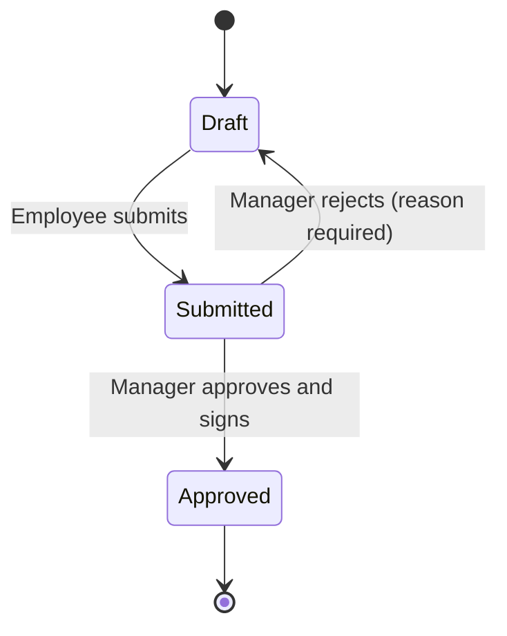

<!-- Read-only copy of Product Requirements (PRD): https://app.notion.com/p/3f5771bd4d438156a93ec42b3548821d
     Notion is the master; comment and edit there, then run docs-sync.
     Notion last edited: 2026-10-17T14:11:57.318Z · Synced: 18/10/2026 -->
<content>
<callout icon="🎯" color="gray_bg">
	**Status:** Draft · **Last updated:** <mention-date start="2026-10-18"/> · **Type:** Product requirements — *what* we're building and *why*. How it's built lives in the <mention-page url="https://app.notion.com/p/3f4771bd4d4380e28d76d2038edbfac4"/>.
</callout>
<table_of_contents/>
---
## 1. Overview
**Problem.** Businesses (small & large) need a reliable & auditable way for employees to record their hours and for managers to review and approve them.
**First customer.** One small business whose casual staff all do the same kind of work. Today the owner collects fortnightly timesheets, signs them, and sends them to the business's accountant, who runs payroll.
**Solution.** A self-hosted web app that works on phones. Each employee fills in their own fortnightly timesheet (start time, rest break and finish time for each day) and the app calculates their hours. A manager approves and signs each timesheet, then downloads one PDF of the fortnight's signed timesheets to send to the accountant.
---
## 2. M1 (MVP) goal
**Goal.** Replace this business's current timesheet process.
**Done when** the business runs one full fortnight on the app: every employee records their hours, a manager approves and signs each timesheet, and the owner sends the app's PDF to the accountant instead of using the current method.
### Constraints
- Self-hosted for one business. All times are in the business's time zone.
- Simple now, extensible later. Timesheets record facts (who, start time, rest break, finish time) and everything else is calculated: hours now, pay rates and levels in later milestones. Later milestones must be able to add more businesses and dimensions (projects, clients, sites) without changing M1 data.
---
## 3. Users & roles
<table header-row="true">
<tr>
<td>Role</td>
<td>Who</td>
<td>Can</td>
</tr>
<tr>
<td>**Employee**</td>
<td>Casual staff</td>
<td>Fill in and submit their own timesheet; see their own timesheets and any rejection reason</td>
</tr>
<tr>
<td>**Manager**</td>
<td>The owner. M1 has one manager, who is also the admin.</td>
<td>Everything an Employee can do (managers may log their own hours), plus approve or reject timesheets, use the admin page, and download the PDF</td>
</tr>
</table>
Each person has their own login. The name on a timesheet comes from the login and can't be edited.
---
## 4. M1 scope
<columns>
	<column>
		### ✅ In M1
		- Sign-in with personal logins
		- Fortnightly timesheet: start time, rest break and finish time per day, with daily, weekly and fortnight hours calculated
		- Autosaved drafts, with Submit and Clear
		- Profile page with a stored signature for everyone
		- Approve (with signature) or reject (with reason)
		- Self-approval, marked as such
		- Admin page: pay schedule, employees, business name and logo
		- One PDF per fortnight of approved timesheets, for the accountant
		- Log of workflow and admin actions
		- Responsive web app for desktop and phone
	</column>
	<column>
		### ❌ Not in M1
		- Recall, and amendments to approved timesheets → M2
		- Weekend and overnight shifts → M2
		- More than one manager, reporting lines and approver overrides → M2
		- Notifications → M2
		- Two-factor sign-in → M2
		- Excel export → M2; CSV → Later
		- Audit history screen and reports → M2
		- Cloud hosting and multiple businesses → M3
		- Projects, clients and other dimensions → M4
		- Pay rates and employee levels → M4
		- Leave → Later
	</column>
</columns>
**Delivery:** in end-to-end slices, each with its API and screens: (1) Profile signature, My timesheet and submit, (2) approvals, (3) admin page, (4) PDF. Until slice 3 exists, users and the pay schedule are set up directly in Keycloak and configuration. Swagger UI is a developer tool, not a milestone.
---
## 5. Screens
<table header-row="true">
<tr>
<td>Screen</td>
<td>Who</td>
<td>What it's for</td>
</tr>
<tr>
<td>**Sign in**</td>
<td>Everyone</td>
<td>Personal login, under the business's name and logo; password change at first sign-in; password reset by email</td>
</tr>
<tr>
<td>**My timesheet**</td>
<td>Employees, Managers</td>
<td>The fortnightly timesheet (layout below)</td>
</tr>
<tr>
<td>**Approvals**</td>
<td>Managers</td>
<td>Submitted timesheets for a fortnight, with any warnings; open one to approve or reject</td>
</tr>
<tr>
<td>**Admin**</td>
<td>Managers</td>
<td>Pay schedule, employees, PDF download, business name and logo</td>
</tr>
<tr>
<td>**Profile**</td>
<td>Everyone</td>
<td>Set up or replace their signature; change password</td>
</tr>
</table>
### My timesheet layout
- **Header:** employee name (from the login) and the pay period, Monday of week 1 to Friday of week 2. The employee switches between the current and previous fortnight; dates are never typed.
- **Week 1 and Week 2:** Monday to Friday only; there are no weekend shifts in M1. Each day has Date, Start time, Rest break (mins), Finish time and Total hours, in that order, as on the business's current timesheet.
- **Totals:** hours for each day, each week and the fortnight.
- **Buttons:** Submit and Clear.
- **On a phone:** usable at 375 px wide without sideways scrolling.
---
## 6. Functional requirements
### Access
<table header-row="true">
<tr>
<td>ID</td>
<td>Requirement</td>
</tr>
<tr>
<td>FR-01</td>
<td>Each person signs in with their own account. A manager creates accounts with a temporary password, which must be changed at first sign-in. Forgotten passwords are reset by email (Keycloak's own emails only). In M1 a password must be at least 8 characters and include both letters and numbers. There's no two-factor sign-in in M1; it arrives in M2.</td>
</tr>
<tr>
<td>FR-02</td>
<td>Employees see only their own timesheets. The manager sees everyone's.</td>
</tr>
<tr>
<td>FR-03</td>
<td>Only managers can approve, reject, use the admin page and download PDFs.</td>
</tr>
</table>
### Pay schedule
<table header-row="true">
<tr>
<td>ID</td>
<td>Requirement</td>
</tr>
<tr>
<td>FR-04</td>
<td>A manager sets the start date of the first fortnight, which must be a Monday. Fortnights then repeat every 14 days, the same for everyone.</td>
</tr>
<tr>
<td>FR-05</td>
<td>The start date can't be changed once any timesheet exists, including an unsubmitted draft. A deleted draft stops counting.</td>
</tr>
<tr>
<td>FR-06</td>
<td>Until the start date is set, employees see "Your manager hasn't set up the pay schedule yet" and can't enter hours.</td>
</tr>
</table>
### Filling in a timesheet
<table header-row="true">
<tr>
<td>ID</td>
<td>Requirement</td>
</tr>
<tr>
<td>FR-07</td>
<td>An employee has one timesheet per fortnight and can fill in the current or the previous fortnight. A rejected timesheet can be fixed whatever its fortnight (FR-17).</td>
</tr>
<tr>
<td>FR-08</td>
<td>Each weekday (Monday to Friday) has a start time, a rest break in minutes and a finish time. Every day is optional.</td>
</tr>
<tr>
<td>FR-09</td>
<td>A filled-in day needs both a start and a finish time. Finish must be after start on the same day, the break must be shorter than the shift, and days after today can't be filled in.</td>
</tr>
<tr>
<td>FR-10</td>
<td>The app calculates hours for each day (finish − start − break), each week and the fortnight. The server's calculation is the one stored; the screen previews it while typing.</td>
</tr>
<tr>
<td>FR-11</td>
<td>Wherever a shift is shown, on screen and in the PDF, it shows both its times and its hours, e.g. 7:30 AM to 8:30 PM, 30 min break, **12h 30m**. Times use a 12-hour clock with AM/PM. Hours use the form **\{hours\}h \{minutes\}m**, always with both parts and two-digit minutes (8h 00m, 0h 45m). Weekly and fortnight totals use the same form and can go past 24 hours (76h 30m). On screen and in the PDF, every hours figure also shows decimal hours in brackets, as on the current sheet, e.g. 8h 10m (8.17). The server stores exact values and calculates every total from them; rounding (to 2 decimal places, half-up) happens only when hours are displayed. A week's decimal can therefore differ from the sum of its rounded days, so the screen and the PDF both carry the note "Totals are calculated from exact times and may differ slightly from the sum of the rounded daily figures."</td>
</tr>
<tr>
<td>FR-12</td>
<td>Changes save automatically as a draft, available on any device the employee signs in on. A draft that has never been submitted is kept for 15 days after its last change, and deleted when the timesheet is submitted or cleared. The timesheet shows the date its draft will expire. Rejected timesheets never expire unless cleared (FR-13).</td>
</tr>
<tr>
<td>FR-13</td>
<td>Clear empties the whole timesheet, after a confirmation. A rejected timesheet that has been cleared is deleted 3 months later unless hours are entered again; the deletion is logged. The timesheet shows the date it will be deleted.</td>
</tr>
<tr>
<td>FR-14</td>
<td>Submit is available once at least one day has hours, including before the fortnight ends. It opens a review of every day with hours (times, break and hours), any warnings, and the week and fortnight totals. Before the timesheet is sent, the employee ticks one declaration, "I confirm these hours are correct", plus a separate tick for each day with a warning. Their signature, name, and the date and time are then applied, logged and printed on the PDF. A submitted timesheet is read-only to the employee.</td>
</tr>
<tr>
<td>FR-27</td>
<td>A day with 1 hour or less, or more than 12 hours, of worked time (after the break) shows a warning on its row and in the review, e.g. "This shift is 1h 00m. Is AM/PM correct?" Warnings never block saving or submitting.</td>
</tr>
</table>
### Approval
<table header-row="true">
<tr>
<td>ID</td>
<td>Requirement</td>
</tr>
<tr>
<td>FR-15</td>
<td>Managers see the submitted timesheets for a fortnight and can open each one. Any FR-27 warnings show on the days they apply to.</td>
</tr>
<tr>
<td>FR-16</td>
<td>Approve applies the manager's signature, records the approver and the date and time, and locks the timesheet. Approved timesheets can't be changed in M1.</td>
</tr>
<tr>
<td>FR-17</td>
<td>Reject requires a reason. The timesheet returns to the employee, editable and showing the reason; they fix it and submit again, even if its fortnight is no longer the current or previous one. A rejected timesheet never expires while it has hours (cleared ones: FR-13).</td>
</tr>
<tr>
<td>FR-18</td>
<td>Managers can't edit anyone's entries.</td>
</tr>
<tr>
<td>FR-19</td>
<td>A manager may approve their own timesheet. It is marked **Self-approved** on screen and in the PDF.</td>
</tr>
</table>
### Signatures
<table header-row="true">
<tr>
<td>ID</td>
<td>Requirement</td>
</tr>
<tr>
<td>FR-20</td>
<td>Everyone has a Profile page where they set up a signature, either by drawing it or by typing text (their name by default) to generate one. It's stored, reused, and can be replaced at any time. Employees need one before their first submit, and the manager before their first approval; anyone without one is prompted to set it up at that point.</td>
</tr>
<tr>
<td>FR-21</td>
<td>Each submission and approval keeps the signature used at the time. Replacing a signature doesn't change earlier timesheets.</td>
</tr>
</table>
### PDF for the accountant
<table header-row="true">
<tr>
<td>ID</td>
<td>Requirement</td>
</tr>
<tr>
<td>FR-22</td>
<td>A manager downloads one PDF per fortnight, A4 portrait, with a page per approved timesheet. Each page copies the business's current timesheet: the title "Employee Timesheet"; employee name; pay period (Monday of week 1 to Friday of week 2); Week 1 and Week 2 tables with Day, Date, Start Time, Rest Break (mins), Finish Time and Total Hours excluding breaks, each with a weekly total; the fortnight total; then a signature section with the employee's name, signature, and confirmation date and time, and the approver's name, signature, and approval date and time. Labels follow the current sheet's wording.</td>
</tr>
<tr>
<td>FR-23</td>
<td>Only approved timesheets are included. Before downloading, the screen lists that fortnight's timesheets that aren't approved yet, leaving out empty ones.</td>
</tr>
</table>
### Admin page
<table header-row="true">
<tr>
<td>ID</td>
<td>Requirement</td>
</tr>
<tr>
<td>FR-24</td>
<td>Managers have an admin page, separate from Approvals, to set the pay schedule (FR-04), set the business name and logo (FR-28) and manage employees: add, deactivate and reset password.</td>
</tr>
<tr>
<td>FR-25</td>
<td>Deactivated people can't sign in. Their timesheets are kept.</td>
</tr>
<tr>
<td>FR-28</td>
<td>A manager sets the business's name and, optionally, a logo (PNG or JPG, up to 1 MB) on the admin page. The sign-in pages show them, so staff know they're in the right place. Until a name is set, the sign-in pages just say "Timesheets".</td>
</tr>
</table>
### Log
<table header-row="true">
<tr>
<td>ID</td>
<td>Requirement</td>
</tr>
<tr>
<td>FR-26</td>
<td>These actions are logged with who, when and what: submit (with the submitted hours and the employee's confirmation), reject (with the reason), approve, deletion of a cleared rejected timesheet (FR-13), PDF download, signature change, pay schedule set, business name or logo change, and every account change. Draft autosaves and Clear aren't logged. Account changes made directly in Keycloak (at install, before the admin page exists, or in an emergency) are recorded by Keycloak's admin events, kept indefinitely. There is no screen for either log in M1.</td>
</tr>
</table>
### Timesheet lifecycle

---
## 7. Quality requirements
Product promises to the business and its staff. Qualities that shape the architecture are the architecture drivers in the <mention-page url="https://app.notion.com/p/3f4771bd4d4380e28d76d2038edbfac4"/>.
<table header-row="true">
<tr>
<td>Area</td>
<td>Requirement</td>
</tr>
<tr>
<td>**Devices & browsers**</td>
<td>Desktop and phone browsers; current versions of Chrome, Edge, Firefox and Safari.</td>
</tr>
<tr>
<td>**Language**</td>
<td>English only.</td>
</tr>
<tr>
<td>**Accessibility**</td>
<td>After M1, targeting WCAG 2.2 AA.</td>
</tr>
<tr>
<td>**Data retention**</td>
<td>Submitted and approved timesheets and the log are kept indefinitely. Drafts as in FR-12; cleared rejected timesheets as in FR-13.</td>
</tr>
<tr>
<td>**Backups**</td>
<td>A documented backup and restore procedure, with a restore tested before go-live. The business hosts the app, and it holds the record of what people are owed.</td>
</tr>
<tr>
<td>**Install requirements**</td>
<td>An email (SMTP) account for the business, so password-reset emails can be sent.</td>
</tr>
</table>
---
## 8. Success measures *(proposed)*
- The M1 "done when" in section 2 is met.
- After go-live: days from the end of a fortnight to the PDF download, and rejected timesheets per fortnight.
---
## 9. Roadmap
<table header-row="true">
<tr>
<td>Milestone</td>
<td>Focus</td>
<td>Features</td>
</tr>
<tr>
<td>**M1 — MVP**</td>
<td>One self-hosted business</td>
<td>Everything in section 4</td>
</tr>
<tr>
<td>**M2**</td>
<td>Usability & control</td>
<td>Recall; amendments to approved timesheets; weekend and overnight shifts; multiple managers, reporting lines and approver overrides; email notifications and reminders; Excel export; audit history screen; basic reports; more soft warnings (e.g. unusually long weeks); review of leavers' drafts; accessibility (WCAG 2.2 AA); two-factor sign-in</td>
</tr>
<tr>
<td>**M3**</td>
<td>Cloud & SaaS</td>
<td>Cloud hosting; multiple businesses (tenants) and onboarding; Platform Admin; per-tenant single sign-on; configurable periods (weekly, monthly); self-service data access and erasure (GDPR)</td>
</tr>
<tr>
<td>**M4**</td>
<td>Business features</td>
<td>Dimensions (projects, clients, sites, work types); pay rates, including evening, weekend and holiday rates; employee levels; billing and invoicing; payroll and accounting integrations; public API and webhooks</td>
</tr>
<tr>
<td>**Later**</td>
<td>Enterprise extras</td>
<td>Multi-level approvals; CSV export; leave tracking; advanced analytics; native mobile apps; multiple languages; data residency; tamper-evident log; configurable data retention</td>
</tr>
</table>
---
## 10. Decision log
<table header-row="true">
<tr>
<td>Date</td>
<td>Decision</td>
<td>Why</td>
</tr>
<tr>
<td><mention-date start="2026-10-11"/></td>
<td>M1 serves one self-hosted business with casual staff</td>
<td>A real user and a clear finish line, instead of a configurable platform for an imagined customer</td>
</tr>
<tr>
<td><mention-date start="2026-10-11"/></td>
<td>No projects or other dimensions in M1</td>
<td>Staff do one kind of work. Adding dimensions later doesn't touch existing data</td>
</tr>
<tr>
<td><mention-date start="2026-10-11"/></td>
<td>Store start time, rest break and finish time; the server calculates hours</td>
<td>Times are needed to calculate hours, to check entries, and to add evening and weekend rates later. A number calculated in the browser can't be trusted</td>
</tr>
<tr>
<td><mention-date start="2026-10-11"/></td>
<td>Fortnightly periods from a start date a manager sets</td>
<td>Matches the pay cycle; one schedule for everyone</td>
</tr>
<tr>
<td><mention-date start="2026-10-11"/></td>
<td>Show both the times (12-hour clock, e.g. 7:30 AM to 8:30 PM) and the hours (12h 30m) wherever a shift appears</td>
<td>Owner's preference. Seeing both lets anyone check the calculation, and the "h m" form can't be mistaken for a clock time or for decimal hours</td>
</tr>
<tr>
<td><mention-date start="2026-10-11"/></td>
<td>Autosave instead of a Save button; only Submit and Clear</td>
<td>Nothing typed is lost, and there are fewer buttons on a phone</td>
</tr>
<tr>
<td><mention-date start="2026-10-11"/></td>
<td>Never-submitted drafts expire 15 days after their last change; deleted on submit or clear</td>
<td>Longer than a fortnight, so a shift entered on the first day survives until after the fortnight ends. Replaces the 8 days first proposed, which could delete a shift mid-fortnight</td>
</tr>
<tr>
<td><mention-date start="2026-10-11"/></td>
<td>Reject with a reason is in M1; recall and amendments are M2</td>
<td>Reject covers mistakes found before approval: the employee asks the manager to reject</td>
</tr>
<tr>
<td><mention-date start="2026-10-11"/></td>
<td>Everyone keeps a signature on their Profile page, drawn once or generated from typed text, then reused</td>
<td>Matches the paper sheet, which the employee and the owner both sign. A one-time effort; the login and the logged action are the real proof</td>
</tr>
<tr>
<td><mention-date start="2026-10-11"/></td>
<td>Managers may approve their own timesheet; it's marked Self-approved</td>
<td>Owner-run business; the accountant can see it</td>
</tr>
<tr>
<td><mention-date start="2026-10-11"/></td>
<td>One manager in M1, who is also the admin</td>
<td>One small owner-run business. The app checks for the manager role, not a count of managers, so M2 can add more without rework</td>
</tr>
<tr>
<td><mention-date start="2026-10-11"/></td>
<td>Build in end-to-end slices</td>
<td>Each slice is usable by someone, and the screens shape the API</td>
</tr>
<tr>
<td><mention-date start="2026-10-11"/></td>
<td>The timesheet and PDF copy the business's current timesheet: A4 portrait, days as rows, columns Start, Rest Break, Finish, Total</td>
<td>The accountant gets the layout they already process. The sample also revealed an employee signature line and decimal hours (Q4)</td>
</tr>
<tr>
<td><mention-date start="2026-10-11"/></td>
<td>Fortnights start on a Monday</td>
<td>Week 1 and Week 2 run Monday first, as on the current sheet</td>
</tr>
<tr>
<td><mention-date start="2026-10-11"/></td>
<td>A soft warning for days with 1 hour or less, or more than 12 hours, worked is in M1</td>
<td>Catches the most likely 12-hour-clock mistake (AM instead of PM), which passes every hard check</td>
</tr>
<tr>
<td><mention-date start="2026-10-11"/></td>
<td>Hours show both forms on screen and in the PDF, e.g. 8h 10m (8.17)</td>
<td>Staff read hours and minutes; the accountant keeps the decimal figures they key in today. The screen mirrors the PDF, so staff see the same figures the accountant does</td>
</tr>
<tr>
<td><mention-date start="2026-10-11"/></td>
<td>Submit needs one declaration plus a tick for each day with a warning, not a tick for every day</td>
<td>Ticking every day turns into reflexive tapping. Extra effort goes to the days most likely to be wrong</td>
</tr>
<tr>
<td><mention-date start="2026-10-11"/></td>
<td>M1 records weekday shifts only (Monday to Friday)</td>
<td>The current sheet has no weekend rows. Weekend shifts move to M2</td>
</tr>
<tr>
<td><mention-date start="2026-10-11"/></td>
<td>The manager sees shift warnings when approving</td>
<td>The manager is the second check on AM/PM mistakes</td>
</tr>
<tr>
<td><mention-date start="2026-10-11"/></td>
<td>A rejected timesheet stays fixable after its editing window closes</td>
<td>Otherwise a rejection could leave hours that can't be corrected</td>
</tr>
<tr>
<td><mention-date start="2026-10-11"/></td>
<td>No empty submissions; the current fortnight can be submitted early</td>
<td>Staff with no hours don't submit. Later days can't be filled in anyway, and the manager can reject if more shifts come in</td>
</tr>
<tr>
<td><mention-date start="2026-10-11"/></td>
<td>The install needs an email (SMTP) account</td>
<td>Keycloak needs it to send password-reset emails</td>
</tr>
<tr>
<td><mention-date start="2026-10-11"/></td>
<td>Rejected timesheets with hours never expire; only drafts that were never submitted do (cleared rejected timesheets: FR-13)</td>
<td>A rejected timesheet holds hours the manager has already seen, so deleting it could leave someone unpaid. Corrects the fresh 15-day expiry first agreed for Q7</td>
</tr>
<tr>
<td><mention-date start="2026-10-11"/></td>
<td>Keycloak admin events are turned on and kept indefinitely</td>
<td>Account changes made directly in Keycloak bypass the app's log; this keeps FR-26's promise that every account change is recorded</td>
</tr>
<tr>
<td><mention-date start="2026-10-11"/></td>
<td>A cleared rejected timesheet is deleted 3 months after it was cleared, unless hours are entered again</td>
<td>Stops empty rejected timesheets lingering forever, while leaving time to recover from an accidental clear</td>
</tr>
<tr>
<td><mention-date start="2026-10-11"/></td>
<td>Hours are rounded only for display; the server stores exact values</td>
<td>Totals stay exact. How values are stored (minutes, decimals) is an engineering decision for the design docs</td>
</tr>
<tr>
<td><mention-date start="2026-10-11"/></td>
<td>A never-submitted draft and a cleared rejected timesheet both show the date they'll be deleted</td>
<td>Nobody's hours disappear without warning</td>
</tr>
<tr>
<td><mention-date start="2026-10-18"/></td>
<td>The manager sets the business name and an optional logo on the admin page; the sign-in pages show them (FR-28)</td>
<td>Owner's request during the mock-up review. The sign-in pages match the app's look, and the business's own name and logo tell staff they're in the right place</td>
</tr>
<tr>
<td><mention-date start="2026-10-18"/></td>
<td>M1 password rule: at least 8 characters, with letters and numbers (FR-01)</td>
<td>A simple rule staff can follow on a phone; it can be tightened later</td>
</tr>
<tr>
<td><mention-date start="2026-10-18"/></td>
<td>No two-factor sign-in in M1; it moves to M2 (FR-01)</td>
<td>Owner's decision during the mock-up review: keeps sign-in simple while the app replaces paper. Until then the manager account relies on its password and Keycloak's protection against password guessing</td>
</tr>
</table>
---
## 11. Open questions
None. Q1–Q11 are resolved; their outcomes are in the FRs and the decision log.
---
## 12. Product risks
<table header-row="true">
<tr>
<td>Risk</td>
<td>Mitigation</td>
</tr>
<tr>
<td>Hours people worked are lost when a draft expires</td>
<td>15-day expiry for never-submitted drafts only, with the expiry date shown on the timesheet (FR-12); rejected timesheets with hours never expire, and a cleared one is deleted only after 3 months, with the date shown (FR-13)</td>
</tr>
<tr>
<td>The accountant misreads or mistypes hours from the PDF</td>
<td>Hours also shown in decimal, as on today's sheet (FR-11); Excel export in M2</td>
</tr>
<tr>
<td>Data loss on a self-hosted server</td>
<td>Documented, tested backup and restore (section 7)</td>
</tr>
<tr>
<td>The only manager is away, so nobody can approve and pay is late</td>
<td>Whoever runs the server can add a second manager in Keycloak in an emergency; multiple managers in M2</td>
</tr>
<tr>
<td>A weekend shift has nowhere to be recorded</td>
<td>Confirm the business doesn't work weekends; weekend shifts in M2</td>
</tr>
<tr>
<td>Scope creep</td>
<td>Strict M1 scope; everything else goes to the roadmap</td>
</tr>
<tr>
<td>Keeping data indefinitely vs GDPR's storage-limitation principle</td>
<td>Revisit retention before M3</td>
</tr>
</table>
---
## 13. Related documents
- <mention-page url="https://app.notion.com/p/3f4771bd4d4380e28d76d2038edbfac4"/>
- <mention-page url="https://app.notion.com/p/3f5771bd4d43813e90c8e11492d92e2b"/>
- <mention-page url="https://app.notion.com/p/3f5771bd4d43819981e0f96e66fae263"/>
### Revision history
<table header-row="true">
<tr>
<td>Date</td>
<td>Change</td>
</tr>
<tr>
<td><mention-date start="2026-10-11"/></td>
<td>Created from the product content of the HL Design Doc</td>
</tr>
<tr>
<td><mention-date start="2026-10-11"/></td>
<td>Rewritten around the new M1: one self-hosted business, casual staff, fortnightly timesheets, and a signed PDF for the accountant. Milestones replace version numbers, features dropped from M1 moved to the roadmap, and FRs renumbered. Later the same day: FR-11 now shows 12-hour times alongside hours; Q1 resolved (drafts expire after 15 days); Q2 resolved (one manager in M1); Q3 resolved: the timesheet and PDF now copy the business's current timesheet, with a soft warning (FR-27) and a review-and-confirm step on submit (FR-14). Then: Q4 and Q5 resolved, signatures for everyone on a new Profile page, weekends dropped from M1, FR-27's boundary fixed, and Q6–Q10 added. Then: Q6–Q10 resolved. Then: cleared rejected timesheets deleted after 3 months, rounding for display only, date and time on both signatures. Q11 resolved (decimal hours on screen too); no open questions remain.</td>
</tr>
<tr>
<td><mention-date start="2026-10-11"/></td>
<td>Consistency fixes: FR-26 now lists the logged deletion of a cleared rejected timesheet; the decision-log and risk rows on rejected timesheets mention FR-13's exception for cleared ones. FR-13: the timesheet shows the date it will be deleted, as drafts already do.</td>
</tr>
<tr>
<td><mention-date start="2026-10-18"/></td>
<td>Added FR-28: business name and optional logo, set on the admin page and shown on the sign-in pages. FR-26 now logs changes to them; the screens table and M1 scope mention them.</td>
</tr>
<tr>
<td><mention-date start="2026-10-18"/></td>
<td>FR-01: the M1 password rule, and no two-factor sign-in in M1, which is added to the M2 roadmap and to Not in M1. FR-24 mentions the business name and logo. Section references are now written as words.</td>
</tr>
</table>
</content>
