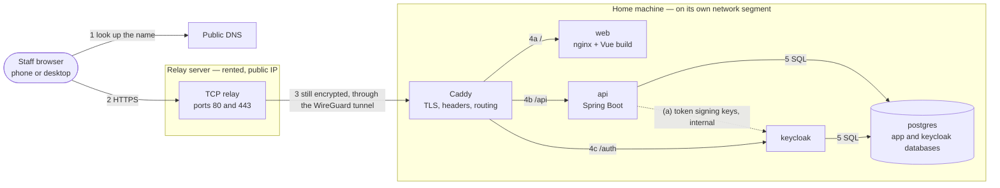
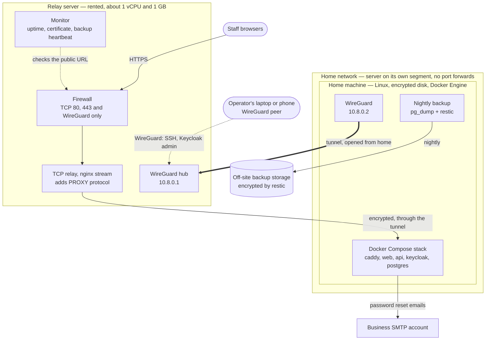
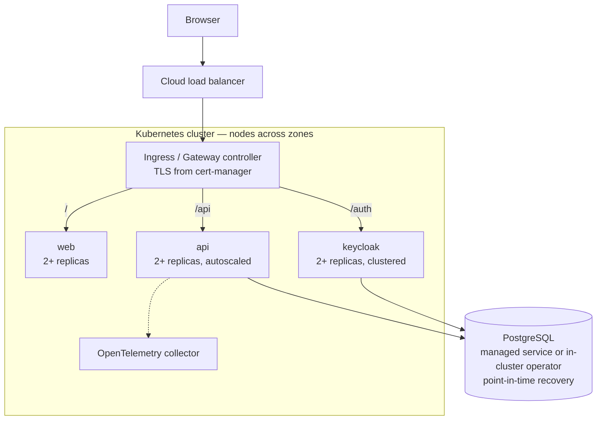

<!-- Read-only copy of System Design: https://app.notion.com/p/3f6771bd4d4381fbadd6f819e59e08fd
     Notion is the master; comment and edit there, then run docs-sync.
     Notion last edited: 2026-10-17T14:50:55.935Z · Synced: 18/10/2026 -->
<content>
<callout icon="🏗️" color="gray_bg">
	**Status:** Draft · **Last updated:** <mention-date start="2026-10-18"/> · **Type:** System design — the detailed design of how the timesheet app runs, and *why* it is built the way it is. The <mention-page url="https://app.notion.com/p/3f4771bd4d4380e28d76d2038edbfac4"/> says *what* the system is; requirements live in the <mention-page url="https://app.notion.com/p/3f5771bd4d438156a93ec42b3548821d"/>; code-level detail lives in the <mention-page url="https://app.notion.com/p/3f5771bd4d43813e90c8e11492d92e2b"/> and the <mention-page url="https://app.notion.com/p/3f5771bd4d43819981e0f96e66fae263"/>.
</callout>
<table_of_contents/>
---
## 1. Purpose and scope
This document covers how the system runs and the reasoning behind its design:
- How a request travels from a phone to the database: network, reverse proxy and TLS (sections 2–4)
- Where it runs in M1 and M3, and in which environments (sections 5 and 6)
- How it scales, how big it needs to be, and how it recovers from failure (sections 7–10)
- How it's operated and secured (sections 11 and 12)
- Why each architecture decision (AD) and system decision (SD) was made, with the options considered (section 13)
It doesn't repeat what the building blocks are (HLD sections 3–5), the product requirements (PRD) or code-level design (BE and FE docs).
**Terms.** The *operator* is whoever runs the server (PRD section 12). The *home machine* is the computer at the operator's home that runs the app in M1. The *relay* is a small rented server that gives the home machine a public address without opening anything at home (section 5.1).
### M1 and M3 at a glance
<table header-row="true">
<tr>
<td></td>
<td>M1 (MVP)</td>
<td>M3</td>
</tr>
<tr>
<td>Serves</td>
<td>One small business</td>
<td>Many businesses (tenants), as SaaS</td>
</tr>
<tr>
<td>Runs on</td>
<td>A home machine with Docker Compose, reached through a rented relay</td>
<td>A Kubernetes cluster at a cloud provider</td>
</tr>
<tr>
<td>Entry point</td>
<td>Caddy on the home machine</td>
<td>Cloud load balancer and an Ingress / Gateway controller</td>
</tr>
<tr>
<td>Copies of each service</td>
<td>One</td>
<td>Two or more; the API autoscales</td>
</tr>
<tr>
<td>Recovery</td>
<td>Restore from a nightly off-site backup: up to 24 hours of data lost, back within one business day</td>
<td>Managed database with point-in-time recovery; 99.9% availability</td>
</tr>
</table>
### Drivers this design meets
<table header-row="true">
<tr>
<td>HLD driver</td>
<td>Target</td>
<td>Where</td>
</tr>
<tr>
<td>Security</td>
<td>TLS outside local development; least privilege; nothing exposed that doesn't need to be</td>
<td>Sections 2.3, 3, 4, 11.4 and 12</td>
</tr>
<tr>
<td>Availability</td>
<td>M1: one instance, recovered from a tested backup. M3: 99.9%</td>
<td>Sections 5, 7 and 10</td>
</tr>
<tr>
<td>Recoverability</td>
<td>A documented backup and restore, tested before go-live</td>
<td>Section 9</td>
</tr>
<tr>
<td>Performance</td>
<td>API p95 under 300 ms at M1 load</td>
<td>Section 8</td>
</tr>
<tr>
<td>Portability</td>
<td>The same images on Docker Compose and Kubernetes</td>
<td>Sections 5 and 6</td>
</tr>
<tr>
<td>Observability</td>
<td>Logs, metrics, traces and correlation IDs</td>
<td>Section 11.2</td>
</tr>
</table>
---
## 2. Network and request path
### 2.1 How a request reaches the app (M1)

1. **Name lookup.** The browser looks up the app's hostname (for example `timesheet.example.com`) and gets the relay's public IP address. The home machine's address never appears in DNS.
2. **HTTPS to the relay.** The browser connects to the relay on port 443. Port 80 is open only so that plain `http://` links redirect to HTTPS and certificate checks work (section 4.2).
3. **Through the tunnel, still encrypted.** The relay passes the encrypted connection, unopened, through a WireGuard tunnel that the home machine keeps open to it. It adds a PROXY protocol header so Caddy knows the browser's real IP address. The relay never holds a certificate and never sees timesheet data.
4. **Caddy.** On the home machine, Caddy ends TLS, adds security headers, refuses blocked paths and routes by path: (4a) `/` to the web app, (4b) `/api` to the API, (4c) `/auth` to Keycloak (section 2.2).
5. **Data.** The API checks the token, then reads or writes PostgreSQL. Keycloak keeps its own database on the same PostgreSQL server.
The response goes back the same way. (a) The API fetches Keycloak's token-signing keys over the internal network, never through Caddy (section 2.5).
### 2.2 One hostname, routed by path
All traffic uses one hostname (AD-12, AD-20). Caddy refuses the blocked paths first, then routes the rest:
<table header-row="true">
<tr>
<td>Path</td>
<td>Goes to</td>
<td>Public?</td>
<td>Notes</td>
</tr>
<tr>
<td>`/` and anything not listed below</td>
<td>web (nginx)</td>
<td>Yes</td>
<td>The Vue app. Paths that aren't files fall back to `index.html`, so the app's own routes work.</td>
</tr>
<tr>
<td>`/api/v1/…`</td>
<td>api</td>
<td>Yes</td>
<td>The REST API. Swagger UI and the OpenAPI document are switched off in the production install (SD-09).</td>
</tr>
<tr>
<td>`/auth/realms/timesheet/…`, `/auth/resources/…`</td>
<td>keycloak</td>
<td>Yes</td>
<td>Sign-in, the password change at first sign-in, password reset, the token endpoint, discovery and signing keys, and the styles for Keycloak's pages. Keycloak is configured to live under `/auth`.</td>
</tr>
<tr>
<td>`/auth/admin/…`</td>
<td>—</td>
<td>**No, refused by Caddy**</td>
<td>Keycloak's admin console and admin API. The operator reaches the console over WireGuard only (section 11.4); the API's service account calls the admin API over the internal network.</td>
</tr>
<tr>
<td>`/auth/realms/master/…`</td>
<td>—</td>
<td>**No, refused by Caddy**</td>
<td>Keycloak's built-in super-admin realm.</td>
</tr>
<tr>
<td>`/auth/realms/timesheet/account/…`</td>
<td>—</td>
<td>**No, refused by Caddy**</td>
<td>Keycloak's Account Console, which is also turned off in the realm. Password change goes through the app's Profile page (FE section 6.4), and nobody can edit their own name, because the name on a timesheet comes from the login (PRD section 3).</td>
</tr>
</table>
Health and metrics endpoints (the API's management port and Keycloak's management port 9000) and PostgreSQL are never routed at all.
### 2.3 What's exposed
<table header-row="true">
<tr>
<td>Machine</td>
<td>Open to</td>
<td>Ports</td>
<td>Purpose</td>
</tr>
<tr>
<td>Relay</td>
<td>The internet</td>
<td>TCP 443 and 80</td>
<td>Forwarded, unopened, to Caddy at home. On port 80 Caddy only redirects to HTTPS and answers certificate checks.</td>
</tr>
<tr>
<td>Relay</td>
<td>The internet, but silent to anyone without a key</td>
<td>UDP 51820</td>
<td>WireGuard hub for the home machine and the operator's devices</td>
</tr>
<tr>
<td>Relay</td>
<td>WireGuard peers only</td>
<td>SSH; the monitor's dashboard</td>
<td>Relay administration (section 11.4)</td>
</tr>
<tr>
<td>Home router</td>
<td>Nothing</td>
<td>None</td>
<td>No port forwards; the home machine only connects outwards</td>
</tr>
<tr>
<td>Home machine</td>
<td>The relay only, over WireGuard</td>
<td>TCP 80 and 443</td>
<td>Caddy; PROXY protocol headers accepted only from the relay</td>
</tr>
<tr>
<td>Home machine</td>
<td>The operator's devices only, over WireGuard</td>
<td>SSH, keys only</td>
<td>Administration, and the tunnel to Keycloak's admin console</td>
</tr>
<tr>
<td>Containers</td>
<td>Compose networks only</td>
<td>web 8080; api 8080 and its management port; keycloak 8080 and 9000; postgres 5432</td>
<td>Never published on the host</td>
</tr>
</table>
Docker adds its own firewall rules for published ports, and they bypass the usual host firewall tools. So only Caddy publishes ports, only on the home machine's WireGuard address, and the `DOCKER-USER` firewall chain accepts them from the relay alone.
### 2.4 Inside the home machine
<table header-row="true">
<tr>
<td>Compose network</td>
<td>Members</td>
<td>Internet access</td>
<td>Why</td>
</tr>
<tr>
<td>`edge`</td>
<td>caddy, web, api, keycloak</td>
<td>Outbound only</td>
<td>Caddy reaches the services. Caddy needs the certificate authority, and Keycloak the SMTP server.</td>
</tr>
<tr>
<td>`data`</td>
<td>api, keycloak, postgres</td>
<td>None (an internal network)</td>
<td>Only the two services that own data can reach PostgreSQL; Caddy and the web app can't.</td>
</tr>
</table>
The backup job runs on the host, not in a container (section 9.3).
### 2.5 Tokens and the issuer URL
- Keycloak issues tokens whose issuer is its **public** URL (`https://timesheet.example.com/auth/realms/timesheet`), because that's where browsers sign in.
- The API checks every token's issuer against that public URL, but fetches Keycloak's signing keys from its **internal** address (`http://keycloak:8080/auth/…`) and caches them. Token checks never leave the machine and don't depend on DNS, the relay or the certificate.
- The catch: the API can't find the keys through OIDC discovery from the issuer URL alone, because that would go out through the relay. So the issuer and the keys URL are configured separately. A Backend-for-Frontend, if chosen (FE section 3), exchanges sign-in codes for tokens at the internal address in the same way. Configuration: BE section 5.
- M3 uses the same split inside the cluster.
---
## 3. Reverse proxy and Ingress
### 3.1 Why one entry point
Every request, sign-in included, enters through one reverse proxy (AD-20). That gives:
- **One origin.** The web app, the API and the sign-in pages share one hostname. The browser needs no cross-origin (CORS) rules, and a session cookie, if a Backend-for-Frontend is chosen (FE section 3), can be host-only, `Secure`, `HttpOnly` and `SameSite`.
- **One place for TLS.** One certificate, renewed automatically in one place (section 4).
- **Nothing else exposed.** Only the paths in section 2.2 can be reached. Keycloak's admin console, the health endpoints and the database can't, whatever their own settings.
- **One place for headers and limits.** Security headers, request size limits and access logs are set once, not in every service.
- **The same shape as M3.** The Kubernetes Ingress does the same job, so M3 swaps the entry point without redesigning anything (section 3.4).
### 3.2 Caddy and nginx: two different jobs
Both are web servers that can serve files and act as reverse proxies. The design uses them in two places:
<table header-row="true">
<tr>
<td></td>
<td>Caddy — the front door</td>
<td>nginx — inside the web app image</td>
</tr>
<tr>
<td>Job</td>
<td>The single public entry point: HTTPS and certificates, routing `/`, `/api` and `/auth`, security headers, refusing blocked paths</td>
<td>Serves the built Vue files; unknown paths fall back to `index.html`; cache headers; the Content Security Policy (SD-10)</td>
</tr>
<tr>
<td>M1</td>
<td>On the home machine</td>
<td>Behind Caddy</td>
</tr>
<tr>
<td>M3</td>
<td>Replaced by the Ingress</td>
<td>The same image, behind the Ingress</td>
</tr>
</table>
Comparing the two for the front-door job:
<table header-row="true">
<tr>
<td></td>
<td>Caddy</td>
<td>nginx</td>
</tr>
<tr>
<td>Certificates</td>
<td>Gets and renews them itself (built-in ACME client)</td>
<td>Needs a separate certbot job, and a reload of nginx after each renewal</td>
</tr>
<tr>
<td>HTTPS defaults</td>
<td>Modern TLS settings and the HTTP-to-HTTPS redirect out of the box</td>
<td>Protocols, ciphers and redirects configured by hand</td>
</tr>
<tr>
<td>Configuration</td>
<td>About 30 lines for this app</td>
<td>Longer, plus the certbot setup</td>
</tr>
<tr>
<td>Rate limiting</td>
<td>Needs a plugin (a custom build)</td>
<td>Built in</td>
</tr>
<tr>
<td>Familiarity</td>
<td>Less widely known</td>
<td>The most widely used, with the most documentation</td>
</tr>
<tr>
<td>Written in</td>
<td>Go (memory-safe)</td>
<td>C</td>
</tr>
<tr>
<td>Licence</td>
<td>Apache 2.0</td>
<td>BSD-2-Clause</td>
</tr>
</table>
**Why Caddy at the front door:** automatic renewal removes the most common way a small self-hosted site goes down, an expired certificate, just as certificate lifetimes are getting shorter (section 4.2). The missing built-in rate limiting doesn't matter here: Keycloak's brute-force protection guards the sign-in page, the only thing worth guessing at, and Keycloak's admin console is reachable only over WireGuard (SD-03).
**Why nginx stays in the web image:** its job there is small, it's the usual base for single-page-app images, and the same image runs behind the Ingress in M3, where there is no Caddy. Putting the front-door job in the web image instead would give it M1-only settings (certificates, Keycloak routing) that are wrong in M3.
### 3.3 Caddy configuration (M1)
- **Certificates:** automatic, from Let's Encrypt (section 4.2), with the operator's email as the contact.
- **PROXY protocol:** accepted only from the relay's WireGuard address, so Caddy logs the browser's real IP address. A PROXY header from anywhere else is refused.
- **HTTP/3 off:** the relay forwards TCP only, so Caddy doesn't advertise HTTP/3, which runs over UDP.
- **Routes and refusals:** as in section 2.2. Keycloak and the API trust the forwarded headers (protocol, host, client address) from Caddy only.
- **Headers on every response:** `Strict-Transport-Security` for one year (without `includeSubDomains`, so other services on the business's domain aren't affected), `X-Content-Type-Options: nosniff`, `Referrer-Policy: strict-origin-when-cross-origin`, and a `Permissions-Policy` turning off camera, microphone and location; the `Server` header is removed. The Content Security Policy comes from the web image (SD-10); Keycloak sets its own for its pages.
- **Limits:** request bodies up to 2 MB (a signature image is far smaller); compression for API responses.
- **Logs:** JSON access logs to standard output, kept by Docker with rotation (section 11.2).
*Sketch — the real file lives in the monorepo:*
```plain text
{
	email {$ACME_EMAIL}
	servers {
		listener_wrappers {
			proxy_protocol {
				allow 10.8.0.1/32
			}
			tls
		}
		protocols h1 h2
	}
}

{$SITE_HOST} {
	encode zstd gzip
	request_body {
		max_size 2MB
	}
	header {
		Strict-Transport-Security "max-age=31536000"
		X-Content-Type-Options "nosniff"
		Referrer-Policy "strict-origin-when-cross-origin"
		Permissions-Policy "camera=(), microphone=(), geolocation=()"
		-Server
	}

	@blocked path /auth/admin* /auth/realms/master* /auth/realms/timesheet/account*
	respond @blocked 404

	handle /api/* {
		reverse_proxy api:8080
	}
	handle /auth/* {
		reverse_proxy keycloak:8080
	}
	handle {
		reverse_proxy web:8080
	}
}
```
### 3.4 M3: the Ingress
- The same routes and refusals become Kubernetes routing rules; certificates come from cert-manager (section 4.4); the relay goes away and a cloud load balancer takes its place.
- Kubernetes has two routing APIs: the older Ingress and the newer Gateway API. The widely used ingress-nginx controller was retired in March 2026, so M3 should choose a maintained Gateway API implementation (for example Envoy Gateway or Traefik), decided in M3 (section 14). These docs say "Ingress" for whichever is chosen.
---
## 4. TLS and certificates
### 4.1 Where traffic is encrypted
<table header-row="true">
<tr>
<td>Hop</td>
<td>Protection</td>
<td>Why</td>
</tr>
<tr>
<td>Browser → relay → Caddy</td>
<td>TLS end to end, ending at Caddy on the home machine</td>
<td>Passwords, signatures and hours cross the internet. The relay passes encrypted bytes, so neither it nor its provider can read them.</td>
</tr>
<tr>
<td>Relay ↔ home machine</td>
<td>Also inside WireGuard</td>
<td>The tunnel is how the relay reaches a home machine with no open ports; its encryption is a second layer.</td>
</tr>
<tr>
<td>Caddy → web, api, keycloak; api and keycloak → postgres</td>
<td>Plain HTTP and the plain PostgreSQL protocol, on private Docker networks</td>
<td>The traffic never leaves the machine. Anyone able to read it already controls the host (SD-05).</td>
</tr>
<tr>
<td>Keycloak → SMTP server</td>
<td>TLS required</td>
<td>Password-reset emails carry reset links.</td>
</tr>
<tr>
<td>Backups → off-site storage</td>
<td>Encrypted by restic before they leave the machine, then sent over TLS</td>
<td>The storage provider never sees the data (section 9.3).</td>
</tr>
<tr>
<td>Operator → home machine</td>
<td>WireGuard, then SSH</td>
<td>Admin access is never open to the internet (section 11.4).</td>
</tr>
</table>
### 4.2 Certificates in M1
- Caddy gets a certificate for the app's hostname from **Let's Encrypt** (free, automated and trusted by every browser) and renews it by itself once about a third of its lifetime is left. Both of the challenge types Caddy uses (HTTP on port 80 and TLS on port 443) work, because the relay forwards both ports.
- **Why automatic renewal matters:** public certificate lifetimes are shrinking. Let's Encrypt certificates last 90 days today, and Let's Encrypt has announced a move to 45 days by 2028. Industry rules (the CA/Browser Forum) cap every public certificate at 200 days from March 2026, 100 days from March 2027 and 47 days from March 2029. Manual renewal would soon be a monthly chore, and one forgotten renewal makes every phone refuse the site, with no workaround for staff.
- **Our own expiry check:** Let's Encrypt stopped emailing expiry warnings in 2025, so the monitor on the relay checks the certificate daily and alerts the operator when fewer than 14 days are left. That only happens if automatic renewal has been failing for more than two weeks (section 11.2).
- **While setting up**, Caddy points at Let's Encrypt's staging service, so configuration mistakes don't use up the production rate limits.
- Caddy keeps the certificate and its ACME account in its data volume, which is backed up (section 9.2), so a restore doesn't need a new certificate straight away.
### 4.3 Local development
Caddy uses its own local certificate authority for `https://localhost`, so development runs over HTTPS like production: secure cookies, the same paths, the same Keycloak setup. Each developer trusts Caddy's local root certificate once.
### 4.4 M3
cert-manager (Apache 2.0) gets and renews certificates from Let's Encrypt inside the cluster, including one per domain if tenants later bring their own. Connections to a managed PostgreSQL use TLS with certificate verification.
---
## 5. Deployment topology
### 5.1 M1: home machine behind a relay

**Why a relay** (full record: AD-21):
- **Nothing listens at home.** The home router forwards no ports. The home machine only makes outbound connections: WireGuard to the relay, Let's Encrypt, SMTP and the backup storage.
- **The home address stays hidden.** DNS points at the relay.
- **It works on any broadband.** Many home connections share one public address between customers (CGNAT) or change address from time to time; the tunnel is opened from home, so neither matters.
- **The relay can't read anything.** It forwards encrypted TCP; certificates, keys and data stay at home. If it's broken into, the attacker gets ciphertext, plus a tunnel that reaches only Caddy and an SSH port that needs the operator's key.
- **It's replaceable.** Rebuilding the relay at any provider takes under an hour from its config in the monorepo, plus a DNS change.
**The relay**
- The smallest server any provider offers (about 1 vCPU, 1 GB RAM, 10 GB disk), running Linux with automatic security updates.
- Firewall: accepts only TCP 80 and 443 and UDP 51820 (WireGuard). SSH listens only on its WireGuard address.
- WireGuard hub at 10.8.0.1. Its peers are the home machine (10.8.0.2) and the operator's devices (10.8.0.10 upwards). Forwarding rules let operator peers reach the home machine's SSH, and nothing else crosses between peers.
- TCP relay: nginx's `stream` module, used purely as a pipe. It adds the PROXY protocol header and never decrypts (SD-12).
- Also runs the external monitor (section 11.2), because the home machine can't report its own outage.
*Relay sketch:*
```plain text
stream {
	server {
		listen 443;
		proxy_pass 10.8.0.2:443;
		proxy_protocol on;
	}
	server {
		listen 80;
		proxy_pass 10.8.0.2:80;
		proxy_protocol on;
	}
}
```
**The home machine**
- Linux (Debian or Ubuntu LTS) with Docker Engine and the Compose plugin, not Docker Desktop (SD-04).
- Connected to the home router by Ethernet, and walled off from the home network: it can reach the internet, but not other home devices, and they can't reach it. The home router, an eero Pro 7, can't separate a wired device (it has no VLANs, and its guest network is Wi-Fi only), so this happens in two steps (SD-14):
	- **Until go-live:** the server's own firewall blocks traffic to and from the home network, and nothing listens except on WireGuard. On the eero, UPnP is off, so nothing can open ports by itself, and the server has a reserved IP address.
	- **Before go-live:** a small router running OpenWrt sits between the eero and the server, and its firewall walls the server off. Unlike the server's own firewall, a compromised server can't change it.
- Full-disk encryption, unlocked by the machine's TPM at boot, so it restarts unattended after a power cut while a removed or discarded disk stays unreadable (SD-04).
- Firmware set to power on after a power cut; Docker, WireGuard and the Compose stack start at boot.
- Clock kept right by NTP: "today", expiry dates and token checks depend on it.
- Automatic security updates for the operating system; container images are updated on purpose (section 11.3).
- Size: section 8.3.
### 5.2 M1: services in the Compose stack
<table header-row="true">
<tr>
<td>Service</td>
<td>Image</td>
<td>Networks</td>
<td>Storage</td>
<td>Health check</td>
<td>Starts after</td>
</tr>
<tr>
<td>caddy</td>
<td>Official Caddy image</td>
<td>edge</td>
<td>`caddy_data` (certificates), `caddy_config`</td>
<td>—</td>
<td>web, api, keycloak</td>
</tr>
<tr>
<td>web</td>
<td>Ours: nginx and the Vue build</td>
<td>edge</td>
<td>None</td>
<td>HTTP check on nginx</td>
<td>—</td>
</tr>
<tr>
<td>api</td>
<td>Ours: Spring Boot on an Eclipse Temurin 25 JRE</td>
<td>edge, data</td>
<td>None (data and signatures are in PostgreSQL)</td>
<td>Spring Boot readiness, on its management port</td>
<td>postgres and keycloak healthy</td>
</tr>
<tr>
<td>keycloak</td>
<td>Official Keycloak image, with our realm configuration</td>
<td>edge, data</td>
<td>None (its data is in PostgreSQL)</td>
<td>Keycloak readiness, on management port 9000</td>
<td>postgres healthy</td>
</tr>
<tr>
<td>postgres</td>
<td>Official PostgreSQL image</td>
<td>data</td>
<td>`pg_data` (both databases)</td>
<td>`pg_isready`</td>
<td>—</td>
</tr>
</table>
- Every image is pinned by version and digest, so what was tested is what runs (section 11.3).
- Only caddy publishes ports: 80 and 443, on the WireGuard address (section 2.3).
- Every service restarts automatically (`restart: unless-stopped`) and logs to standard output, which Docker sends to the system journal (section 11.2).
- The API runs its Flyway migrations as it starts (AD-10); Keycloak migrates its own database when upgraded.
- Containers run as non-root users, with read-only file systems where the image allows.
- Secrets are kept in files, not in the Compose file (section 6.2).
### 5.3 M3: Kubernetes

- The same images as M1 (AD-08), deployed with Helm; configuration from ConfigMaps and Secrets, or an external secret store.
- Nodes spread across availability zones; PodDisruptionBudgets keep at least one replica of each service running during node maintenance.
- Rolling updates with readiness probes and graceful shutdown, so upgrades have no downtime.
- Keycloak replicas share sessions through Keycloak's built-in distributed cache.
- The relay, Caddy and the host-level backups go away; the cloud load balancer, the Ingress and the managed database's backups replace them.
### 5.4 M1 and M3 compared
<table header-row="true">
<tr>
<td>Concern</td>
<td>M1</td>
<td>M3</td>
</tr>
<tr>
<td>Hosting</td>
<td>Home machine behind a rented relay</td>
<td>Kubernetes at a cloud provider</td>
</tr>
<tr>
<td>Entry point</td>
<td>Caddy, behind the relay</td>
<td>Cloud load balancer and an Ingress / Gateway controller</td>
</tr>
<tr>
<td>TLS</td>
<td>Let's Encrypt, through Caddy</td>
<td>Let's Encrypt, through cert-manager</td>
</tr>
<tr>
<td>Packaging</td>
<td>Same images, Docker Compose</td>
<td>Same images, Helm</td>
</tr>
<tr>
<td>Scaling</td>
<td>One instance of each</td>
<td>Web and API scale out; the database is the limit</td>
</tr>
<tr>
<td>Database</td>
<td>PostgreSQL container with a volume</td>
<td>Managed PostgreSQL or an in-cluster operator, decided in M3</td>
</tr>
<tr>
<td>Configuration and secrets</td>
<td>`.env` and secret files</td>
<td>ConfigMaps and Secrets, or an external secret store</td>
</tr>
<tr>
<td>Backups</td>
<td>Nightly, encrypted, off-site</td>
<td>Managed backups with point-in-time recovery</td>
</tr>
<tr>
<td>Monitoring</td>
<td>Monitor on the relay; logs on the host</td>
<td>OpenTelemetry collector and a monitoring stack</td>
</tr>
<tr>
<td>Admin access</td>
<td>WireGuard, then SSH</td>
<td>The provider's identity and access controls; Keycloak's admin console still never public</td>
</tr>
<tr>
<td>Upgrades</td>
<td>A few minutes' downtime, out of hours</td>
<td>Rolling, no downtime</td>
</tr>
</table>
---
## 6. Environments
### 6.1 Environments
<table header-row="true">
<tr>
<td>Environment</td>
<td>Where</td>
<td>Purpose</td>
<td>Data</td>
<td>Differences</td>
</tr>
<tr>
<td>**Local development**</td>
<td>Each developer's machine (Docker Engine, Podman Desktop or Rancher Desktop)</td>
<td>Building and debugging</td>
<td>Seeded test data; Keycloak realm imported from the repo, with test users</td>
<td>Caddy's local certificates (section 4.3); Swagger UI on; emails caught by Mailpit (MIT) instead of being sent</td>
</tr>
<tr>
<td>**CI**</td>
<td>The CI runner</td>
<td>Every change: unit, integration (Testcontainers), contract and end-to-end tests against the full Compose stack (HLD section 12)</td>
<td>Created for each run, then thrown away</td>
<td>Builds the images once; later environments use exactly those images</td>
</tr>
<tr>
<td>**Rehearsal**</td>
<td>A clean machine or virtual machine, when needed</td>
<td>The restore test before go-live, and trying each upgrade before production (SD-08)</td>
<td>Restored from a production backup, so treated like production: encrypted disk, wiped afterwards</td>
<td>Not reachable from the internet</td>
</tr>
<tr>
<td>**Production**</td>
<td>The home machine behind the relay</td>
<td>The business's live install</td>
<td>Real</td>
<td>—</td>
</tr>
</table>
M1 has no permanent staging server (SD-08). M3 adds a permanent staging environment.
### 6.2 Configuration and secrets
- Every environment runs the same images; only configuration differs (AD-09).
- Non-secret settings (hostname, the business's time zone, the pay schedule start date until slice 3, the certificate contact email) are in `.env`.
- Secrets (database passwords, the Keycloak admin password, the API's Keycloak service-account secret, the SMTP password) are in files readable only by root on the host, passed to containers as Compose secrets where the image supports reading them from files.
- `.env`, the secret files and the Compose file for the install aren't in git; the monorepo holds templates. All of them are in the backup (section 9.2).
- The keys that unlock everything else (the backup repository password, the backup storage credentials, the WireGuard private keys and the Keycloak admin login) are also kept in the operator's password manager and in a sealed copy held by the business owner. A restore then depends on neither the home machine nor one person (section 9.4).
### 6.3 Images
- CI builds the `web` and `api` images once per release and pushes them to a container registry (choice open, section 14). Production pulls them by digest.
- Third-party images (Caddy, Keycloak, PostgreSQL) are pinned by version and digest and updated on purpose (section 11.3).
---
## 7. Scaling and load balancing
### 7.1 M1: one copy of each, no load balancer
- **The load is tiny** (section 8). A busy hour at the end of a fortnight is a few requests a second; one API instance handles hundreds.
- **A second copy wouldn't add resilience.** The likely M1 failures are the home machine itself, its power or its broadband (section 10), and a second container on the same machine survives none of them. Resilience in M1 comes from automatic restarts, monitoring and a tested restore.
- **Upgrades take a few minutes of downtime,** out of hours (section 11.3). Zero-downtime upgrades are an M3 need.
- Caddy can balance across several copies if one is ever wanted; nothing else would change.
### 7.2 Rules that keep M3 scaling possible
These apply from M1, so M3 changes the deployment, not the code:
- **No state in the API's memory** between requests (AD-07). If a Backend-for-Frontend is chosen (FE section 3), its sessions are stored in PostgreSQL.
- **No files on local disk.** Signatures are in PostgreSQL; PDFs are generated and streamed, never stored.
- **Scheduled jobs run once,** however many API replicas there are: the daily job that deletes expired drafts and cleared rejected timesheets takes a database lock first (SD-11).
- **Migrations run once:** Flyway locks its history table, so only one replica migrates. In M3 a pre-deploy job can run them instead.
- **Graceful shutdown:** the API finishes requests in flight before stopping, and reports not-ready while starting or stopping.
- **Connection budget:** API replicas × connection pool size stays below PostgreSQL's connection limit.
### 7.3 M3: load balancing and autoscaling
- The cloud load balancer sends traffic to the Ingress controller's replicas; Kubernetes Services spread requests across the ready pods of each service.
- Readiness probes take a pod out of rotation while it starts, stops or can't reach the database.
- The API autoscales on CPU, with at least two replicas; web runs two fixed replicas; Keycloak at least two.
- PostgreSQL is the scaling limit: first a bigger instance, then read replicas for reports, and a connection pooler (PgBouncer) if connections run out.
### 7.4 Scaling path
1. Stateless web and API scale out (M3).
2. Database read replicas for reports and exports, once data grows.
3. Heavy work such as exports and reports moves to background workers (revisit AD-17 with M2's Excel export and reports).
4. Modules are extracted into separate services only if a measured need appears (AD-01).
---
## 8. Capacity
### 8.1 M1 load
*Sized for up to 50 staff, comfortably more than one small business needs.*
<table header-row="true">
<tr>
<td>Activity</td>
<td>Per fortnight</td>
<td>Peak</td>
</tr>
<tr>
<td>Autosaves (one per changed day, after typing pauses)</td>
<td>About 50 staff × 10 days × 5 saves ≈ 2,500</td>
<td>A few a second in the last hour before submissions are due</td>
</tr>
<tr>
<td>Page loads and reads</td>
<td>A few thousand</td>
<td>As above</td>
</tr>
<tr>
<td>Submissions and approvals</td>
<td>Up to 50 of each, plus any rejections</td>
<td>Bunched at the end of the fortnight</td>
</tr>
<tr>
<td>Fortnight PDF</td>
<td>Usually one, up to 50 pages</td>
<td>Renders in seconds</td>
</tr>
<tr>
<td>Sign-ins</td>
<td>A few hundred</td>
<td>—</td>
</tr>
</table>
Even the peak is far below what one API instance handles, so meeting the p95 target of 300 ms (HLD section 2.1) is about query design, not capacity. The web app's first load is under 1 MB compressed and then cached, so a home broadband upload speed of 10 Mbit/s or more is plenty.
### 8.2 Storage growth
<table header-row="true">
<tr>
<td>Data</td>
<td>Per year (50 staff, 26 fortnights)</td>
</tr>
<tr>
<td>Timesheets and days</td>
<td>Under 10 MB</td>
</tr>
<tr>
<td>Signature copies (about 20 KB each; one per submission and one per approval)</td>
<td>About 50 MB</td>
</tr>
<tr>
<td>Log records</td>
<td>Under 10 MB</td>
</tr>
<tr>
<td>Keycloak, including admin events</td>
<td>Under 50 MB</td>
</tr>
</table>
The database stays under 1 GB for a decade. Backups are deduplicated, so off-site storage grows at about the same rate; a few GB covers years of history (section 9).
### 8.3 Machine sizes
<table header-row="true">
<tr>
<td>Component</td>
<td>Memory limit (planned)</td>
</tr>
<tr>
<td>Keycloak</td>
<td>1.5 GB</td>
</tr>
<tr>
<td>API (JVM)</td>
<td>1 GB</td>
</tr>
<tr>
<td>PostgreSQL</td>
<td>512 MB</td>
</tr>
<tr>
<td>Caddy and web (nginx)</td>
<td>100 MB together</td>
</tr>
<tr>
<td>Operating system, Docker, WireGuard, backup job</td>
<td>1 GB</td>
</tr>
<tr>
<td>**Total**</td>
<td>**About 4 GB**</td>
</tr>
</table>
**Home machine:** 64-bit; 4 CPU cores (2 minimum); 8 GB RAM (4 GB minimum, but upgrades and Java start-up need headroom); an SSD with 64 GB free; a TPM 2.0 chip for disk unlocking; a wired network connection. Most retired desktops and mini PCs qualify.
**Relay:** 1 vCPU, 1 GB RAM, 10 GB disk; traffic well under 10 GB a month.
---
## 9. Backups and disaster recovery
### 9.1 Targets (M1)
<table header-row="true">
<tr>
<td>Target</td>
<td>Value</td>
<td>Why it's enough</td>
</tr>
<tr>
<td>**RPO** — the most data that can be lost</td>
<td>24 hours (nightly backup, plus one before every upgrade)</td>
<td>Staff can re-enter a lost day while its fortnight is still the current or previous one (FR-07), and the manager can approve again.</td>
</tr>
<tr>
<td>**RTO** — the longest time to be back</td>
<td>One business day</td>
<td>Pay is fortnightly: a day's outage delays nothing unless it falls on the approval day, and then the PDF goes to the accountant a day later.</td>
</tr>
</table>
Tighter targets are possible later with continuous archiving of PostgreSQL's write-ahead log (for example with pgBackRest), at the cost of more setup.
### 9.2 What's backed up
<table header-row="true">
<tr>
<td>Item</td>
<td>How</td>
<td>Why</td>
</tr>
<tr>
<td>App database</td>
<td>`pg_dump`, custom format</td>
<td>Timesheets, signatures, submissions, approvals, the business name and logo, and the log</td>
</tr>
<tr>
<td>Keycloak database</td>
<td>`pg_dump`, custom format</td>
<td>Accounts, roles, password hashes and admin events (FR-26)</td>
</tr>
<tr>
<td>PostgreSQL roles</td>
<td>`pg_dumpall --globals-only`</td>
<td>The database users and their permissions, including the app user that can't change log rows (BE section 7)</td>
</tr>
<tr>
<td>Install configuration</td>
<td>File copy</td>
<td>`.env`, secret files, the Compose file, the Caddyfile and the WireGuard configuration: everything needed to rebuild the stack</td>
</tr>
<tr>
<td>Caddy data</td>
<td>File copy</td>
<td>The certificate and ACME account, so a restore doesn't run into certificate rate limits</td>
</tr>
</table>
Not backed up: container images (pulled again by their pinned digests), PDFs (generated on demand), container logs (short-lived) and the relay (rebuilt from its config in the monorepo).
### 9.3 How
- A systemd timer on the home machine runs at 02:00 business time. It dumps both databases and the roles through the `postgres` container, then **restic** (BSD-2-Clause) backs up the dumps and the configuration.
- restic encrypts everything on the home machine before upload and deduplicates, so nightly copies of a mostly unchanged database take little space.
- **Off-site copy (required):** an S3-compatible bucket or an SFTP server away from the home (provider open, section 14), which survives fire, theft or a dead disk. *Proposed:* where the storage supports it, the home machine's credentials can add backups but not delete them, so malware on the home machine can't destroy them; old backups are pruned from the operator's laptop.
- **Local copy (recommended):** a second restic repository on a USB disk attached to the home machine, for fast restores.
- **Retention** *(proposed)*: 7 daily, 4 weekly and 12 monthly backups, plus one a year kept indefinitely; pre-upgrade backups kept for 3 months.
- **Checks:** `restic check` weekly. Each successful run sends a heartbeat to the relay's monitor, which alerts if a night's heartbeat is missing (section 11.2).
- The same job is run by hand before every upgrade (section 11.3).
### 9.4 Restore
1. Prepare a Linux machine (the repaired home machine, a replacement or, in an emergency, a rented server) with Docker Engine, WireGuard and restic.
2. Using the keys from the password manager or the sealed copy (section 6.2), restore the latest configuration and dumps from restic.
3. Start PostgreSQL. Restore the roles, then both databases with `pg_restore`.
4. Start the rest of the stack, using the pinned image digests.
5. Bring up WireGuard with the home machine's key. The relay forwards to it as before; a rented server used temporarily takes the same key, so neither DNS nor the relay changes.
6. Check: sign in as an employee and as the manager, open the last fortnight, download its PDF, and confirm the latest log records are there.
**When it's tested:** on a clean machine before go-live (PRD section 7), after every major upgrade, and at least once a year. Each test records how long it took, as a check on the RTO. The step-by-step version is in the runbook (section 11.5).
### 9.5 M3
- Managed PostgreSQL with point-in-time recovery (an RPO of minutes) for both databases, decided with the database hosting choice (section 14).
- Restoring one tenant without touching the others is hard with a shared schema. Tenant-level export and restore is designed with the isolation strategy before M3 (BE section 6).
---
## 10. Failure modes (M1)
<table header-row="true">
<tr>
<td>Failure</td>
<td>What users see</td>
<td>How it's noticed</td>
<td>Recovery</td>
</tr>
<tr>
<td>Home power cut or broadband outage</td>
<td>The app is unreachable. Nothing already saved is lost; unsaved typing stays on the phone marked "Not saved" (FE section 7.1)</td>
<td>The relay's monitor alerts</td>
<td>Comes back by itself: the firmware powers on, the TPM unlocks the disk, Docker and WireGuard start. Staff catch up within the editing window (FR-07)</td>
</tr>
<tr>
<td>Relay down, or its provider has an outage</td>
<td>The app is unreachable</td>
<td>The home machine checks the public URL every 5 minutes and emails the operator (email doesn't go through the relay)</td>
<td>Wait, or rebuild the relay at another provider from its config and update DNS (under an hour)</td>
</tr>
<tr>
<td>Home machine's disk or hardware fails</td>
<td>The app is unreachable; up to a day's entries lost</td>
<td>The relay's monitor alerts</td>
<td>Restore onto a replacement or a temporary rented server (section 9.4) within one business day; staff re-enter lost days and the manager approves again</td>
</tr>
<tr>
<td>Disk full</td>
<td>Saves fail; autosave shows "Not saved"</td>
<td>Alert at 80% disk use</td>
<td>The journal's 2 GB cap and image pruning prevent it. Free space, and saves resume</td>
</tr>
<tr>
<td>Certificate renewal keeps failing</td>
<td>Nothing until it expires; then phones refuse the site</td>
<td>Alert when fewer than 14 days are left</td>
<td>Fix the cause (relay forwarding, DNS, an outage at the certificate authority); Caddy retries by itself</td>
</tr>
<tr>
<td>Keycloak down</td>
<td>Nobody can sign in. People already signed in carry on until their session next needs Keycloak, within minutes</td>
<td>The health check restarts it; the monitor checks the sign-in page</td>
<td>Restart; restore its database if it's corrupted</td>
</tr>
<tr>
<td>API down</td>
<td>Errors; autosave keeps changes in memory and retries</td>
<td>The health check restarts it; the monitor checks an API health route</td>
<td>Restart; read the logs; roll back the last upgrade if it caused it</td>
</tr>
<tr>
<td>Bad upgrade or migration</td>
<td>Errors or wrong data after an upgrade</td>
<td>The smoke test straight after the upgrade</td>
<td>The previous image digests plus the pre-upgrade backup (section 11.3)</td>
</tr>
<tr>
<td>SMTP account stops working</td>
<td>Password-reset emails don't arrive</td>
<td>Staff report it; Keycloak's logs</td>
<td>Fix the SMTP settings. Meanwhile the manager resets passwords from the admin page, with a temporary password</td>
</tr>
<tr>
<td>Backups failing silently</td>
<td>Nothing, until a restore is needed</td>
<td>The missing nightly heartbeat alerts by the next morning</td>
<td>Fix it, run a backup by hand, run `restic check`</td>
</tr>
<tr>
<td>Clock wrong</td>
<td>Wrong "today", expiry dates and timestamps; sign-ins fail</td>
<td>The home machine's checks include NTP status</td>
<td>NTP keeps it right; fix NTP</td>
</tr>
<tr>
<td>Home machine compromised</td>
<td>Possibly nothing, until data is misused</td>
<td>Hard to notice; hardening is the defence (section 12)</td>
<td>Disconnect it, rebuild from a clean operating system, restore a backup from before the compromise, change every secret</td>
</tr>
<tr>
<td>Operator unavailable</td>
<td>Nothing, until something needs fixing</td>
<td>—</td>
<td>The runbook and the sealed keys let someone else restore or add a manager (section 11.5)</td>
</tr>
</table>
---
## 11. Operations
### 11.1 Install prerequisites (M1)
- A home machine that meets section 8.3, set up as in section 5.1, behind its own OpenWrt router (SD-14).
- A rented relay server (section 5.1), and a domain name with a DNS record pointing the app's hostname at the relay.
- WireGuard keys for the home machine and for each of the operator's devices.
- An email (SMTP) account for the business, for Keycloak's password-reset emails (FR-01, PRD section 7) and the operator's alerts.
- Off-site backup storage, and a restic repository password (section 9.3).
- Keycloak set up from the realm configuration in the repo: admin events on, with no expiry (FR-26); brute-force protection on; a password policy of at least 8 characters with letters and numbers; no two-factor sign-in for app accounts in M1 (SD-03); the Account Console off; the initial admin account replaced by a named admin with two-factor sign-in.
- The business's time zone and, until slice 3, the pay schedule start date, in configuration.
- A tested restore (section 9.4) before go-live, and the runbook (section 11.5).
### 11.2 Monitoring and alerts (M1)
<table header-row="true">
<tr>
<td>Check</td>
<td>From</td>
<td>Alerts when</td>
</tr>
<tr>
<td>App reachable: web page, sign-in page, API health route</td>
<td>Relay monitor, every minute</td>
<td>Two failures in a row</td>
</tr>
<tr>
<td>Certificate expiry</td>
<td>Relay monitor, daily</td>
<td>Fewer than 14 days left</td>
</tr>
<tr>
<td>Nightly backup heartbeat</td>
<td>Relay monitor</td>
<td>No heartbeat by 06:00</td>
</tr>
<tr>
<td>Relay reachable, through the public URL</td>
<td>Home machine, every 5 minutes</td>
<td>Two failures in a row (alert by email)</td>
</tr>
<tr>
<td>Disk use and NTP status</td>
<td>Home machine, hourly</td>
<td>Disk over 80%, or the clock not synchronised</td>
</tr>
<tr>
<td>Container health</td>
<td>Docker health checks</td>
<td>The container is restarted; repeated restarts show up in the reachability checks</td>
</tr>
</table>
- *Proposed* monitor: Uptime Kuma (MIT) on the relay, with its dashboard reachable over WireGuard only. Alerts go to the operator by email and push notification (SD-13). It keeps 90 days of history.
**How long things are kept**
<table header-row="true">
<tr>
<td>What</td>
<td>Kept for</td>
<td>Why</td>
</tr>
<tr>
<td>Container logs (app, Caddy, Keycloak, PostgreSQL)</td>
<td>1 year or 2 GB, whichever comes first; compressed</td>
<td>Long enough to investigate a problem found late; capped so logs can't fill the disk; personal data in them (user IDs, IP addresses) isn't kept longer than needed</td>
</tr>
<tr>
<td>Monitor history, on the relay</td>
<td>90 days</td>
<td>Enough to see trends; keeps the monitor's own database small</td>
</tr>
<tr>
<td>Audit log and Keycloak's admin events</td>
<td>Indefinitely</td>
<td>Required (FR-26, PRD section 7). They're records, not logs, and grow by about 10 MB a year</td>
</tr>
<tr>
<td>Backups</td>
<td>As in section 9.3</td>
<td>Deduplicated, so they grow slowly</td>
</tr>
<tr>
<td>Metrics and traces</td>
<td>Not collected in M1</td>
<td>Retention is set with the monitoring stack in M3</td>
</tr>
</table>
- Logs: every service logs structured JSON with a correlation ID to standard output (HLD section 7). Docker sends them to the system journal, which keeps them through container upgrades, compresses them, and deletes them after a year or once they reach 2 GB, whichever comes first (SD-15). They're read with `journalctl` or `docker compose logs`. An OpenTelemetry collector and monitoring backends can be added when needed, and arrive with M3 (BE section 8).
### 11.3 Upgrades and patching
- **App releases:** back up (section 9.3), update the pinned image digests, pull and restart the stack; the API migrates the database as it starts; then a smoke test (sign in, open a timesheet, download a PDF). Done out of working hours, with a few minutes' downtime.
- **Rolling back:** the previous digests, plus the pre-upgrade backup if a migration ran, because Flyway migrations only go forward.
- **Third-party images:** Caddy, Keycloak and PostgreSQL patch releases monthly, or straight away for a security fix. Keycloak and PostgreSQL major versions are tried on the rehearsal machine first: Keycloak migrates its database on start, and a PostgreSQL major upgrade needs a dump and restore.
- **Operating systems:** automatic security updates on the home machine and the relay, rebooting in a set early-morning window.
- **CI** scans images and dependencies for vulnerabilities and disallowed licences, and the code and images for secrets, on every build (HLD section 12). The same secret scan runs as a pre-commit hook on developers' machines, so a password or key never enters the git history.
### 11.4 Admin access
- The operator's laptop and phone are WireGuard peers on the relay. Through it they can reach the home machine's SSH (keys only, no passwords) and nothing else.
- Keycloak's admin console is used through an SSH tunnel to the home machine; Caddy never routes it (section 2.2).
- The relay's own SSH and the monitor's dashboard listen only on its WireGuard address.
- In M1 every app account, the manager's included, signs in with a password (at least 8 characters, with letters and numbers), protected by Keycloak's brute-force protection. Two-factor sign-in for the manager comes in M2 (SD-03).
### 11.5 Runbook
A short, step-by-step runbook for the operator, kept in the monorepo and printed with the sealed keys:
- Start, stop and check the stack
- Restore from backup (section 9.4), on the home machine or a temporary rented server
- Upgrade and roll back (section 11.3)
- Give a second person the manager role in Keycloak when the only manager is away (PRD section 12)
- Replace the relay
- Fix a certificate that won't renew
- Change every secret after a suspected compromise
- Who holds the sealed keys
---
## 12. Security layers
Each layer assumes the one in front of it can fail.
<table header-row="true">
<tr>
<td>Layer</td>
<td>Control</td>
<td>Stops</td>
</tr>
<tr>
<td>Home network</td>
<td>No port forwards; UPnP off; the server walled off by its own firewall, then by an OpenWrt router before go-live (SD-14)</td>
<td>Direct attacks on the home router and machine; a compromised server reaching other home devices</td>
</tr>
<tr>
<td>Relay</td>
<td>Only TCP 80 and 443 and WireGuard open; forwards encrypted bytes only</td>
<td>Access to anything except the app; reading traffic on the relay</td>
</tr>
<tr>
<td>Caddy</td>
<td>TLS; only the paths in section 2.2; security headers; size limits</td>
<td>Eavesdropping; reaching Keycloak's admin console, health endpoints or the database</td>
</tr>
<tr>
<td>Keycloak</td>
<td>Brute-force protection; password policy; Account Console off. Two-factor sign-in for the manager in M2 (SD-03)</td>
<td>Password guessing; staff changing their own names</td>
</tr>
<tr>
<td>Web app</td>
<td>Content Security Policy (SD-10); no timesheet data in browser storage (AD-18)</td>
<td>Injected scripts; data left behind on shared phones</td>
</tr>
<tr>
<td>API</td>
<td>Every request authorised by role and ownership (AD-05); input validated</td>
<td>Seeing or changing other people's timesheets</td>
</tr>
<tr>
<td>Database</td>
<td>Unreachable from Caddy and the web app; the log append-only for the app's user (BE section 7)</td>
<td>Direct database access; rewriting history</td>
</tr>
<tr>
<td>Disk and backups</td>
<td>Full-disk encryption; backups encrypted before upload; backup credentials that can't delete</td>
<td>Data read from a stolen disk or at the backup provider; backups wiped by malware</td>
</tr>
<tr>
<td>Operations</td>
<td>Admin access only over WireGuard, with keys; automatic OS updates; pinned and scanned images</td>
<td>Remote attacks on admin interfaces; known vulnerabilities</td>
</tr>
</table>
---
## 13. Decision records
Each record gives the context, the options considered, why the decision was made and its consequences. AD records are the architecture decisions listed in HLD section 8; SD records are system-level decisions kept only here. Where a full comparison already lives in the BE or FE doc, the record summarises it and links there.
### 13.1 Architecture decisions
<details>
<summary>**AD-01 · Modular monolith**</summary>
	**Context:** One small business in M1, a small team, and one home machine with about 4 GB of memory to spend (section 8.3); SaaS in M3.
	**Options:** microservices; a monolith without enforced boundaries; a modular monolith.
	**Why:** One deployable is the simplest to build, test, run and back up, and it fits the home machine: each extra Java service costs 0.5–1 GB. Writing the log record in the same transaction as the action (AD-06) needs one database transaction, which separate services can't share. Microservices would add network calls, partial failures and deployment work, with no scaling need to pay for them. Enforced module boundaries keep the option to split later.
	**Consequences:** One API container. Modules talk only through public interfaces, checked by architecture tests in CI. A module is extracted only if a measured need appears (section 7.4).
</details>
<details>
<summary>**AD-02 · API-first REST + OpenAPI 3, versioned (/api/v1)**</summary>
	**Context:** A browser client now, developer testing through Swagger UI, and a public API in M4.
	**Options:** REST with OpenAPI; GraphQL; gRPC.
	**Why:** REST works natively in browsers and with every tool, and OpenAPI adds Swagger UI, a generated client (AD-13) and contract tests. GraphQL's flexibility isn't needed for a few fixed screens, and it makes per-field authorisation and caching harder. gRPC needs a translating proxy to work in browsers.
	**Consequences:** Versioned paths: a breaking change means `/api/v2` alongside v1. A standard error format and pagination (BE section 4).
</details>
<details>
<summary>**AD-03 · Tenant-aware from day one**</summary>
	**Context:** M3 must add businesses without changing M1 data (PRD section 2).
	**Options:** add tenancy in M3; a separate install per business forever; a tenant identifier on every tenant-owned record from the first migration.
	**Why:** Adding a tenant column to every table and every query later means migrating live data and checking every query for leaks, the riskiest kind of retrofit. Carrying a business ID now costs one column and one filter. Separate installs don't scale to running a SaaS.
	**Consequences:** Every tenant-owned table has a business ID, checked by a test. The isolation strategy (current lean: shared schema with PostgreSQL row-level security) is decided before M3 (BE section 6).
</details>
<details>
<summary>**AD-04 · External identity provider: Keycloak (OIDC)**</summary>
	**Context:** Personal logins, temporary passwords changed at first sign-in and password-reset emails (FR-01), a record of account changes (FR-26), and single sign-on per tenant in M3. Open source only.
	**Options:** build sign-in ourselves; another open-source identity provider (e.g. Authentik, ZITADEL, Ory); a hosted service (e.g. Auth0, Microsoft Entra ID).
	**Why:** Authentication is easy to get wrong and isn't what this product is about. Keycloak is the most mature open-source option (Apache 2.0, a CNCF project) and covers every M1 need out of the box: required actions, reset emails, admin events, brute-force protection and password policies, plus two-factor sign-in for M2 and federation and single sign-on for M3. Hosted services break the open-source and self-hosting constraints. Standard OIDC keeps it replaceable.
	**Consequences:** A second Java service (about 1.5 GB, section 8.3) and a database to back up. Its admin console must never be public (SD-02). Its operational complexity is a tracked risk (HLD section 13).
</details>
<details>
<summary>**AD-05 · RBAC scoped per organisation, enforced in the API**</summary>
	**Context:** Employees see only their own timesheets; only managers approve, reject, use the admin page and download PDFs (FR-02, FR-03). M2 adds more managers and reporting lines.
	**Options:** authorisation in Keycloak (its authorisation services); in the web app; coarse roles in Keycloak, with decisions in the API.
	**Why:** Who may act on a timesheet depends on app data (ownership, status and, later, reporting lines) that only the API has. The web app can be bypassed, so it can only hide buttons. Keycloak's authorisation services would split business rules across two systems and make them harder to test. Checking the role rather than a count of managers lets M2 add managers without rework.
	**Consequences:** Two realm roles, employee and manager. Every endpoint checks role and ownership, and tests cover every permission (HLD section 12).
</details>
<details>
<summary>**AD-06 · Log written in the same transaction as the action**</summary>
	**Context:** FR-26 promises that every listed action is logged.
	**Options:** write the log record in the action's transaction; publish an event and write the log afterwards (e.g. a transactional outbox); database triggers.
	**Why:** One transaction guarantees that neither the action nor its record can exist without the other, with nothing extra to run. An outbox is only needed when the log lives outside the database. Triggers don't know the signed-in user or the business meaning of an action, such as the submitted hours and the confirmation.
	**Consequences:** Log writes add a negligible amount to each action's response time. The log table is append-only for the app's database user (BE section 7).
</details>
<details>
<summary>**AD-07 · Stateless service, JWT bearer tokens**</summary>
	**Context:** M3 runs several API replicas and upgrades without downtime.
	**Options:** sessions in the API's memory (needs sticky routing); stateless, with signed tokens; sessions in a shared store.
	**Why:** If no instance keeps anything in memory between requests, any replica can serve any request, and replicas can be added or replaced freely; in M1 a restart loses nothing. Tokens are checked locally with Keycloak's cached keys, so a request needs no extra call (section 2.5).
	**Consequences:** If a Backend-for-Frontend is chosen (AD-15), its sessions go in PostgreSQL, not memory, so the instances stay stateless. Scheduled jobs need a lock to run only once (SD-11).
</details>
<details>
<summary>**AD-08 · Containers as the unit of deployment**</summary>
	**Context:** The same software must run on a developer's laptop, in CI, on the home machine and on Kubernetes (the portability driver).
	**Options:** install the JAR and nginx directly on the host; virtual machine images; containers.
	**Why:** An image carries its runtime (the Java version, nginx and its configuration), so what passed CI is exactly what runs. Docker Compose gives a one-command install and restore, and Kubernetes runs the same images. Host installs drift from machine to machine; VM images are heavy and don't map onto Kubernetes.
	**Consequences:** Docker Engine on the home machine (SD-04); images built once in CI and pinned by digest (section 6.3).
</details>
<details>
<summary>**AD-09 · 12-factor configuration**</summary>
	**Context:** Several environments (section 6) run the same images.
	**Options:** configuration baked into an image per environment; profile files inside the image; everything external, through the environment.
	**Why:** Baked-in configuration means a rebuild per environment, so production would run an image CI never tested. Keeping secrets out of images and git means a leaked image or repository leaks nothing.
	**Consequences:** `.env` and secret files in M1, ConfigMaps and Secrets in M3 (section 6.2). Templates in the repo; real values only on the machines and in the backup.
</details>
<details>
<summary>**AD-10 · Single PostgreSQL database with versioned migrations**</summary>
	**Context:** Workflow states, signatures and the log must stay consistent; one backup should cover everything (AD-19); M3 needs tenant isolation.
	**Options:** a database per module; a document database; one PostgreSQL database. For migrations: Flyway or Liquibase.
	**Why:** One relational database gives transactions across modules (AD-06) and one thing to back up. PostgreSQL adds row-level security for M3 isolation and JSONB for log details, under a permissive licence. Flyway uses plain, versioned SQL files that are easy to review; Liquibase's extra abstraction isn't needed.
	**Consequences:** The database is the scaling limit (section 7.3), far beyond M1's needs. Keycloak has its own database on the same server. Migrations run at start-up and only go forward (section 11.3). The full comparison of database options, and how they scale, is on the <mention-page url="https://app.notion.com/p/3fc771bd4d4381eb9433c4242b560077"/> page.
</details>
<details>
<summary>**AD-11 · Web app as a Vue 3 + TypeScript single-page app**</summary>
	**Context:** Every screen is behind a login.
	**Options:** a client-rendered single-page app; server-side rendering (Nuxt); static site generation. Full comparison: FE section 2.
	**Why:** Server-side rendering's benefits (search engines, a faster first paint for anonymous visitors) don't apply behind a login, while its cost (a Node server tier to run, scale and secure) does. Static generation only suits content that's the same for everyone.
	**Consequences:** Static files served by nginx in the web image (section 3.2). Revisit if public pages are needed.
</details>
<details>
<summary>**AD-12 · Web app in its own container, on the same domain as the API**</summary>
	**Context:** The web app and the API are built by the same team and often change together.
	**Options:** serve the web app from the Spring Boot app; its own container on the same domain; its own container with the API on a separate subdomain.
	**Why:** Its own container lets the web app and the API be released independently and keeps static file traffic off the JVM. The same domain avoids cross-origin (CORS) rules and keeps cookies first-party, which matters if a Backend-for-Frontend is chosen. A subdomain split would need CORS and cross-site cookie settings for no benefit.
	**Consequences:** Path routing at a single entry point (AD-20).
</details>
<details>
<summary>**AD-13 · OpenAPI spec is the front-end / backend contract**</summary>
	**Context:** The web app is built against an API that changes slice by slice (AD-16).
	**Options:** a hand-written API client; shared TypeScript types; a client generated from the spec.
	**Why:** A generated client turns a breaking API change into a failed web build instead of a production bug, and the spec is one source of truth, reviewed in pull requests.
	**Consequences:** The spec is generated from the API code (springdoc) and checked in CI; the web app regenerates its client from it.
</details>
<details>
<summary>**AD-14 · Monorepo**</summary>
	**Context:** A small team changing the web app, the API and the deployment configuration together.
	**Options:** one repository; separate repositories for web, API and deployment.
	**Why:** Changes that span the API, the client and the deployment configuration (Compose, Caddyfile, relay config, later Helm) land as one reviewed change, with one CI pipeline.
	**Consequences:** CI runs only the jobs a change affects. It can be split later.
</details>
<details>
<summary>**AD-15 · Browser sign-in approach decided in the FE Detailed Design**</summary>
	**Context:** How the browser holds sign-in tokens is the most security-sensitive front-end decision.
	**Options:** tokens in the single-page app; a Backend-for-Frontend (recommended in FE section 3); a token-mediating backend. Full comparison: FE section 3.
	**Why it's decided there:** the choice doesn't change the containers. Either way, all sign-in traffic passes the single entry point (AD-20) on one origin (AD-12).
	**Consequences for the system:** a Backend-for-Frontend adds sessions stored in PostgreSQL (AD-07) and CSRF protection, and exchanges codes for tokens at Keycloak's internal address (section 2.5).
</details>
<details>
<summary>**AD-16 · Deliver in end-to-end slices**</summary>
	**Context:** One team building the web app and the API for a first real user.
	**Options:** the whole API first, then the web app; end-to-end slices, each with its API and screens.
	**Why:** Each slice is usable by someone and can be shown to the business; the screens shape the API, so nothing is built that no screen needs; integration problems show up in the first slice, not at the end.
	**Consequences:** Until slice 3, people and the pay schedule are set up in Keycloak and configuration. Swagger UI is a developer tool, not a milestone.
</details>
<details>
<summary>**AD-17 · PDF generated on the server, on request**</summary>
	**Context:** One PDF per fortnight for the accountant (FR-22), with every download logged (FR-26).
	**Options:** generate it in the browser; on the server, on request; in a background job that stores the file.
	**Why:** The server already enforces who may see the data and logs the download. Browser generation would send all the data to the browser and need heavy libraries there, with less consistent output. A fortnight is at most about 50 pages and renders in seconds, so a background job and file storage aren't needed. Library choice (OpenHTMLtoPDF): BE section 3.3.
	**Consequences:** No stored files (section 7.2). Revisit with M2's reports and Excel export.
</details>
<details>
<summary>**AD-18 · Drafts are server-side, autosaved**</summary>
	**Context:** Staff fill in timesheets on phones, sometimes on more than one device (FR-12), and the server's hours are the ones stored (FR-10).
	**Options:** drafts in browser storage with a Save button; drafts autosaved to the server.
	**Why:** A server draft follows the employee to any device, nothing typed is lost, and no timesheet data stays on a phone that might be shared. The server calculates the hours it stores.
	**Consequences:** Many small requests, still tiny in total (section 8.1); optimistic concurrency for two devices; a daily expiry job (SD-11).
</details>
<details>
<summary>**AD-19 · Backup and restore are part of the deliverable**</summary>
	**Context:** The install holds the record of what people are owed (PRD section 7), on a single home machine.
	**Options:** leave backups to whoever runs the server; ship a documented, tested backup and restore.
	**Why:** A single machine will fail one day, and a backup that has never been restored can't be trusted. Keeping all state in PostgreSQL plus a few configuration files lets one procedure cover everything.
	**Consequences:** Nightly encrypted off-site backups and a restore tested before go-live (section 9).
</details>
<details>
<summary>**AD-20 · One public entry point for all traffic, including sign-in**</summary>
	**Context:** Three things must be public: the web app, the API and Keycloak's sign-in pages. Staff use phones over the internet, so HTTPS is required.
	**Options:** each service on its own public port or subdomain with its own certificate (the HLD's first container drawing had the browser signing in to Keycloak directly); routing folded into the web app's nginx; a dedicated reverse proxy, either Caddy or nginx with certbot.
	**Why:** One entry point gives one origin (no CORS, simple cookies), one certificate, one place for headers and limits, and nothing exposed by accident, Keycloak's admin console above all (section 3.1). Signing in to Keycloak directly would have needed a second public address and certificate and exposed its admin console unless separately locked down. Folding routing into the web image would put M1-only settings into an image that also runs in M3. Caddy over nginx: automatic certificate renewal and secure defaults (section 3.2).
	**Consequences:** Caddy in M1, an Ingress / Gateway controller in M3 (section 3.4). Keycloak runs under `/auth` (SD-02).
</details>
<details>
<summary>**AD-21 · M1 hosted on a home machine behind a rented relay**</summary>
	**Context:** The operator is hosting M1 on a machine at home and wants it to be safe. Staff must reach it from any phone without setting anything up.
	**Options:** open ports on the home router, with dynamic DNS; VPN-only access; a commercial tunnel service (e.g. Cloudflare Tunnel); a rented server running the whole app; the home machine behind a rented relay.
	**Why:** Opening router ports exposes the home IP address and router, and fails behind CGNAT. VPN-only is the most private, but every casual worker would need a VPN app and key on their phone, revoked when they leave. A commercial tunnel decrypts all traffic at the provider and breaks the open-source and vendor-neutral rules. A rented server running everything was not chosen because the operator is hosting at home. The relay keeps the home machine closed to the internet and hidden, works on any broadband, and only ever sees encrypted traffic, for about US\$5 a month.
	**Consequences:** A second small machine to patch. Home power and broadband decide availability, which the editing window absorbs (FR-07). The relay also hosts the external monitor (SD-13). It goes away in M3.
</details>
### 13.2 System decisions
<details>
<summary>**SD-01 · Automatic certificates from Let's Encrypt, with our own expiry check**</summary>
	**Context:** HTTPS is required, and certificate lifetimes are shrinking (section 4.2).
	**Options:** a bought certificate renewed by hand; a self-signed certificate; Let's Encrypt with HTTP and TLS challenges; Let's Encrypt with DNS challenges.
	**Why:** Let's Encrypt is free, trusted everywhere and fully automated through Caddy. Manual renewal will soon be monthly and fails when forgotten. A self-signed certificate makes every phone show a warning, teaching staff to click through warnings. DNS challenges would need a DNS provider API key on the home machine, which isn't necessary because ports 80 and 443 reach Caddy through the relay.
	**Consequences:** The relay forwards port 80 as well as 443. Expiry is monitored independently (section 11.2), since Let's Encrypt no longer emails warnings.
</details>
<details>
<summary>**SD-02 · Keycloak under /auth on the app's hostname; admin paths never public**</summary>
	**Context:** The sign-in pages must be public. The admin console can create users and grant the manager role.
	**Options:** Keycloak on its own subdomain; under a path on the app's hostname, with the admin paths refused.
	**Why:** A path on the same hostname keeps sign-in on the app's origin and needs no second certificate. Refusing the admin console, the master realm and the Account Console at Caddy keeps them unreachable even if a Keycloak setting is wrong. The Account Console is also off, so nobody can change the name that appears on their timesheet (PRD section 3).
	**Consequences:** Keycloak is configured with `http-relative-path=/auth`, the public hostname, a separate admin hostname used through the SSH tunnel, and trust in Caddy's forwarded headers. The operator uses the admin console over WireGuard and SSH (section 11.4).
</details>
<details>
<summary>**SD-03 · Admin access only over WireGuard; two-factor sign-in for the manager in M2**</summary>
	**Context:** The admin console, SSH and the manager account are the most powerful ways in.
	**Options:** for admin interfaces, public with strong passwords, or reachable only over WireGuard. For sign-in, passwords for everyone, two-factor for everyone, or two-factor for the manager only.
	**Why:** Behind WireGuard, admin interfaces can't even be found from the internet. The manager account can approve timesheets and download everyone's data, so two-factor sign-in with an authenticator app is the right next step for it. The owner decided on 18/10/2026 to leave it out of M1 and keep sign-in to a password for everyone, protected by brute-force protection and an 8-character policy with letters and numbers. Requiring it of casual staff on their phones would add friction for little gain, since staff can only reach their own timesheets. Passkeys are a later option; Keycloak supports them.
	**Consequences:** The operator's devices need WireGuard. In M1 a stolen manager password is enough to sign in as the manager; brute-force protection and the password policy are the defences until two-factor sign-in arrives. When it does, the runbook gains a step for a lost manager phone (section 11.5).
</details>
<details>
<summary>**SD-04 · Linux host with Docker Engine, an encrypted disk and its own network segment**</summary>
	**Context:** The home machine holds staff personal data and sits in a home.
	**Options:** Windows or macOS with Docker Desktop, or Linux with Docker Engine. For the disk: no encryption, encryption unlocked by a passphrase at boot, or encryption unlocked by the TPM.
	**Why:** Docker Engine runs natively on Linux, is open source and has no licence conditions; Docker Desktop isn't open source (HLD section 9). Full-disk encryption makes a stolen or discarded disk unreadable. A boot passphrase would also protect against theft of the whole machine, but every power cut would leave the app down until someone typed it, so the TPM unlocks the disk instead. Its own network segment stops a compromised server from reaching other home devices.
	**Consequences:** The machine needs a TPM 2.0 chip, which most PCs from 2016 onwards have. The operator needs basic Linux administration, covered by the runbook.
</details>
<details>
<summary>**SD-05 · Plain HTTP between containers on the one host; TLS wherever traffic leaves it**</summary>
	**Context:** section 4.1.
	**Options:** TLS between every pair of containers; TLS only where traffic leaves the machine.
	**Why:** Traffic between containers stays inside the machine. Anyone able to read it already controls the host and could read the keys too, so internal TLS would add certificate management without stopping a real attack.
	**Consequences:** Revisited in M3, where traffic crosses nodes. A managed PostgreSQL uses verified TLS from the start; encryption between services in the cluster is decided in M3.
</details>
<details>
<summary>**SD-06 · No load balancer or second instance in M1**</summary>
	**Context and why:** section 7.1. The load is tiny, and a second copy on the same machine doesn't survive the failures that matter.
	**Consequences:** A few minutes' downtime per upgrade. The code follows the rules in section 7.2, so M3 can scale out.
</details>
<details>
<summary>**SD-07 · Nightly pg_dump and restic backups, encrypted and off-site**</summary>
	**Context:** AD-19 and the targets in section 9.1: up to 24 hours of data lost, back within one business day.
	**Options:** for the database, copying its files, logical dumps, or continuous write-ahead-log archiving (pgBackRest). For storing backups, restic, Borg or plain copies.
	**Why:** Copying a running database's files can produce an unusable backup. `pg_dump` takes a consistent snapshot of a small database in seconds and restores across PostgreSQL versions. Log archiving would cut the data loss to minutes, but adds setup the M1 targets don't need. restic encrypts before upload, deduplicates, works with S3-compatible storage and SFTP, and is BSD-2-Clause licensed; Borg is similar but needs a Borg server at the other end.
	**Consequences:** The tool and retention are proposed until confirmed, and the storage provider is open (section 14).
</details>
<details>
<summary>**SD-08 · No staging server in M1; a rehearsal machine instead**</summary>
	**Context:** One business and one operator.
	**Options:** a permanent staging server; testing upgrades only in CI; a rehearsal machine restored from backup when needed.
	**Why:** A permanent staging server is one more machine to patch and pay for. Restoring the latest backup onto a clean machine to try each upgrade tests the upgrade on real data and proves the backup at the same time.
	**Consequences:** While in use, the rehearsal machine holds real personal data: encrypted, not reachable from the internet, wiped afterwards. M3 adds a permanent staging environment.
</details>
<details>
<summary>**SD-09 · Swagger UI off in the production install**</summary>
	**Context:** Swagger UI is a developer tool (HLD section 3).
	**Why:** In production it would publish a browsable map of the API. Developers have it locally, and the spec is in the repo.
	**Consequences:** Switched on by configuration in local development only.
</details>
<details>
<summary>**SD-10 · Content Security Policy from the web image; other security headers at the entry point**</summary>
	**Context:** section 3.3.
	**Options:** every header at the entry point; every header in each service; split by what each header depends on.
	**Why:** The Content Security Policy depends on the web app's build (which scripts and styles it loads), so it ships in the web image and moves to M3 with it. HSTS and the other generic headers belong to the domain, so the entry point sets them once. Keycloak sets its own policy for its pages.
	**Consequences:** FE section 11 defines the policy; in M3 the Ingress sets the generic headers.
</details>
<details>
<summary>**SD-11 · Scheduled jobs take a database lock**</summary>
	**Context:** The daily job that deletes expired drafts and cleared rejected timesheets (FR-12, FR-13) must run once, and M3 has several API replicas.
	**Options:** run it as is in M1 and redesign it for M3; a separate scheduler container; a database lock taken by whichever replica runs the job (e.g. ShedLock, Apache 2.0, or a PostgreSQL advisory lock).
	**Why:** A lock in the database the app already uses works the same with one replica or ten, so nothing changes in M3.
	**Consequences:** Library choice in the BE doc.
</details>
<details>
<summary>**SD-12 · Relay: WireGuard plus a TCP relay with PROXY protocol**</summary>
	**Context:** The relay must forward ports 80 and 443 to the home machine without decrypting, and Caddy needs the browser's real IP address for its logs.
	**Options:** firewall port forwarding (nftables); a TCP proxy (nginx's stream module or HAProxy); Caddy with a layer-4 plugin.
	**Why:** Plain port forwarding either hides the real IP address or needs fiddly routing on the home machine. A TCP proxy with PROXY protocol keeps the real address with a ten-line configuration. nginx's stream module comes in the standard package and is well documented; HAProxy would do equally well. Caddy's layer-4 module needs a custom build.
	**Consequences:** Caddy accepts PROXY protocol headers only from the relay's WireGuard address (section 3.3). On the relay, nginx is only a pipe and never sees decrypted traffic.
</details>
<details>
<summary>**SD-13 · Monitoring from the relay, and the home machine watches the relay**</summary>
	**Context:** The home machine can't report its own outage.
	**Options:** a hosted uptime service; a monitor on the relay.
	**Why:** The relay is already a separate machine on a different network, so it sees home outages, and the home machine checks the relay in return. *Proposed:* Uptime Kuma (MIT), which is self-hosted and simple, and supports push heartbeats for the backup job and certificate-expiry checks.
	**Consequences:** The monitor's dashboard is reachable over WireGuard only. It keeps 90 days of history.
</details>
<details>
<summary>**SD-14 · The server walled off from the home network: its own firewall now, an OpenWrt router before go-live**</summary>
	**Context:** The home machine is wired to the home router, an eero Pro 7. It must be walled off from the home network, so a compromised server can't reach other home devices (SD-04). The eero can't separate a wired device: it has no VLANs, and its guest network is Wi-Fi only.
	**Options:** the server's own firewall only; a second router with its own firewall between the eero and the server; replacing the eero with a router that supports VLANs.
	**Why:** The server's own firewall costs nothing and works from day one, but a compromised server could change it. A small, inexpensive router running OpenWrt (open source) enforces the separation from outside the server, without replacing the home Wi-Fi. Replacing the eero would disrupt the whole home network for one server.
	**Consequences:** Until go-live, the server's firewall blocks the home network in both directions, UPnP is off on the eero, and the server has a reserved address. Before go-live, the OpenWrt router is added and its firewall blocks traffic between the server and the home network. The server then sits behind two routers, which doesn't matter because it only makes outbound connections.
</details>
<details>
<summary>**SD-15 · Logs in the system journal: kept a year, compressed, capped at 2 GB**</summary>
	**Context:** Logs grow over time and hold some personal data (user IDs, IP addresses). Docker's default log files are deleted whenever a container is recreated, which happens on every upgrade.
	**Options:** Docker's rotating log files; the system journal (journald) with time and size limits; a separate log store (e.g. Grafana Loki).
	**Why:** The journal keeps logs through upgrades, compresses them, and enforces both a time limit and a size cap, whichever comes first, so logs can never fill the disk. A year is long enough to investigate a problem found late, and no longer than needed for personal data. A separate log store is more to run than M1 needs.
	**Consequences:** Docker's log driver is set to journald, and the journal is configured with `MaxRetentionSec=1year`, `SystemMaxUse=2G` and compression on. Monitor history is kept 90 days. The audit log and Keycloak's admin events aren't logs: they stay indefinitely, as the PRD requires. M3 sets retention in its monitoring stack.
</details>
### 13.3 Technology choices
Why each technology in HLD section 9 was chosen.
<table header-row="true">
<tr>
<td>Area</td>
<td>Choice</td>
<td>Why</td>
</tr>
<tr>
<td>Backend language / runtime</td>
<td>Java 25 (LTS), OpenJDK build</td>
<td>Current long-term-support release, with a long support window</td>
</tr>
<tr>
<td>Backend framework</td>
<td>Spring Boot 4.x</td>
<td>Enterprise standard, with mature security and data support</td>
</tr>
<tr>
<td>Backend build</td>
<td>Maven, with the Maven Wrapper</td>
<td>Predictable, conventional and widely known (comparison with Gradle: BE section 3.1)</td>
</tr>
<tr>
<td>Front-end framework</td>
<td>Vue 3 + TypeScript</td>
<td>Approachable, with official router and state libraries and strong TypeScript support</td>
</tr>
<tr>
<td>Front-end build</td>
<td>Vite</td>
<td>Fast development server and builds; the standard tool for Vue</td>
</tr>
<tr>
<td>UI components</td>
<td>Nuxt UI (v4), without the Nuxt framework</td>
<td>Accessible building blocks (WAI-ARIA, keyboard navigation) and a 12-hour time input, while keeping the single-page app (AD-11)</td>
</tr>
<tr>
<td>Web server, in the web image</td>
<td>nginx</td>
<td>A small, standard static file server; the same image runs in M1 and M3 (section 3.2)</td>
</tr>
<tr>
<td>Reverse proxy (M1)</td>
<td>Caddy</td>
<td>Automatic certificates and secure defaults (AD-20, section 3.2)</td>
</tr>
<tr>
<td>Relay (M1)</td>
<td>WireGuard, and nginx's stream module</td>
<td>A fast, simple, encrypted tunnel opened from home; a TCP pipe that keeps the browser's IP address (AD-21, SD-12)</td>
</tr>
<tr>
<td>Database</td>
<td>PostgreSQL</td>
<td>Robust, with row-level security for multi-tenancy and JSONB for log details (AD-10)</td>
</tr>
<tr>
<td>Schema migrations</td>
<td>Flyway (Community)</td>
<td>Simple, versioned SQL migrations (AD-10)</td>
</tr>
<tr>
<td>Identity</td>
<td>Keycloak</td>
<td>A full OIDC identity provider with single sign-on and two-factor sign-in, running as a container (AD-04)</td>
</tr>
<tr>
<td>API docs / test UI</td>
<td>springdoc-openapi + Swagger UI</td>
<td>The OpenAPI spec generated from code, and interactive testing (AD-02, AD-13)</td>
</tr>
<tr>
<td>PDF export</td>
<td>OpenHTMLtoPDF, community fork</td>
<td>Each page copies the business's paper timesheet, which an HTML template does most directly; OpenPDF and Apache PDFBox were considered (BE section 3.3)</td>
</tr>
<tr>
<td>Excel export (M2)</td>
<td>Apache POI</td>
<td>The standard Java library for .xlsx files</td>
</tr>
<tr>
<td>Containers</td>
<td>OCI images; Docker Engine or Podman</td>
<td>A portable artefact (AD-08)</td>
</tr>
<tr>
<td>Local orchestration</td>
<td>Docker Compose</td>
<td>One command to run the whole stack, for development and the business's M1 install</td>
</tr>
<tr>
<td>Backups (M1)</td>
<td>pg_dump + restic (proposed)</td>
<td>Consistent dumps, encrypted and deduplicated off-site copies (SD-07)</td>
</tr>
<tr>
<td>Monitoring (M1)</td>
<td>Uptime Kuma (proposed)</td>
<td>A simple self-hosted monitor with heartbeats and certificate checks (SD-13)</td>
</tr>
<tr>
<td>Home network firewall (M1)</td>
<td>OpenWrt router, before go-live</td>
<td>Walls the server off from the home network from outside the server, without replacing the home Wi-Fi (SD-14)</td>
</tr>
<tr>
<td>Logs (M1)</td>
<td>systemd journal</td>
<td>Keeps logs through upgrades, compressed, with a time limit and a size cap (SD-15)</td>
</tr>
<tr>
<td>Cloud orchestration (M3)</td>
<td>Kubernetes + Helm, cert-manager</td>
<td>Vendor-neutral and runs on any cloud; automatic certificates in the cluster</td>
</tr>
<tr>
<td>Observability</td>
<td>OpenTelemetry</td>
<td>A vendor-neutral instrumentation standard; backends chosen later (BE section 8)</td>
</tr>
<tr>
<td>Backend testing</td>
<td>JUnit, Testcontainers</td>
<td>Real PostgreSQL and Keycloak in integration tests</td>
</tr>
<tr>
<td>Front-end testing</td>
<td>Vitest, Playwright</td>
<td>Fast unit and component tests; end-to-end tests across browsers</td>
</tr>
<tr>
<td>Secret scanning</td>
<td>gitleaks, as a pre-commit hook and in CI</td>
<td>Catches passwords, keys and tokens before they're committed, and again in CI in case the hook was skipped; once a secret is in the git history it has to be treated as leaked</td>
</tr>
</table>
---
## 14. Open questions
- [ ] Relay provider, and the business's domain name (before go-live)
- [ ] Off-site backup storage provider; confirm restic, the retention (section 9.3) and backup credentials that can't delete
- [ ] Container registry for the web and API images (section 6.3)
- [ ] Monitor on the relay: Uptime Kuma proposed (SD-13)
- [ ] Check the home machine meets section 8.3, including a TPM 2.0 chip
- [ ] Buy and set up the OpenWrt router before go-live, and confirm in the eero app that a wired device can't use the guest network (SD-14)
- [x] Should the PRD mention two-factor sign-in for the manager (FR-01, SD-03)? No: it's not in M1 (owner, 18/10/2026).
- [ ] Observability backends, and whether M1 needs more than logs (BE section 8)
- [ ] M3: Gateway API implementation (section 3.4), PostgreSQL hosting (managed or an in-cluster operator), tenant-level restore (section 9.5), encryption between services (SD-05)
---
## 15. Related documents
- <mention-page url="https://app.notion.com/p/3f5771bd4d438156a93ec42b3548821d"/>
- <mention-page url="https://app.notion.com/p/3f4771bd4d4380e28d76d2038edbfac4"/>
- <mention-page url="https://app.notion.com/p/3f5771bd4d43813e90c8e11492d92e2b"/>
- <mention-page url="https://app.notion.com/p/3f5771bd4d43819981e0f96e66fae263"/>
- <mention-page url="https://app.notion.com/p/3fc771bd4d4381eb9433c4242b560077"/>
### Revision history
<table header-row="true">
<tr>
<td>Date</td>
<td>Change</td>
</tr>
<tr>
<td><mention-date start="2026-10-11"/></td>
<td>Created. Covers the request path, Caddy as the single entry point, TLS and certificates, M1 hosting on a home machine behind a relay, M3 on Kubernetes, environments, scaling, capacity, backups and recovery, failure modes, operations and security layers. Holds the reasoning for every HLD decision (AD-01 to AD-21) and technology choice, and the system decisions SD-01 to SD-13. Took over environments, install prerequisites, and backup and restore from the BE doc.</td>
</tr>
<tr>
<td><mention-date start="2026-10-18"/></td>
<td>Section references are now written as words, not a symbol. The home machine is walled off from the home network by its own firewall, then by an OpenWrt router before go-live, because the eero can't separate a wired device (SD-14). Logs go to the system journal: kept a year, compressed, capped at 2 GB, with a table of how long everything is kept (SD-15).</td>
</tr>
<tr>
<td><mention-date start="2026-10-18"/></td>
<td>SD-03: two-factor sign-in for the manager moves after M1, the owner's decision; M1 uses passwords for everyone, with a policy of at least 8 characters with letters and numbers. Updated the Caddy rationale, the Keycloak realm set-up, access (section 11.4), the runbook and the security layers to match, and closed the open question on mentioning two-factor sign-in in the PRD.</td>
</tr>
<tr>
<td><mention-date start="2026-10-18"/></td>
<td>Linked the new Database Options page (why PostgreSQL, and how the options scale) from AD-10 and the related documents.</td>
</tr>
<tr>
<td><mention-date start="2026-10-18"/></td>
<td>The app database's backup now lists the business name and logo (FR-28). Secret scanning (gitleaks) runs as a pre-commit hook and in CI, on the code and the images.</td>
</tr>
<tr>
<td><mention-date start="2026-10-18"/></td>
<td>Consistency fix from the docs index: two-factor sign-in for the manager is in M2, as in the PRD roadmap (SD-03, sections 11.4 and 12).</td>
</tr>
</table>
</content>